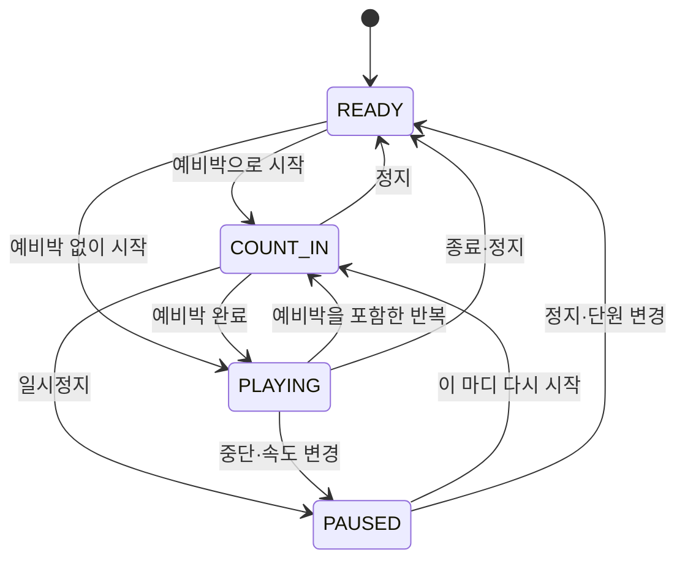

# 교사용 멜로디카 교육 웹앱 상세 설계서

> 제품 가칭: 멜로디카 클래스 · Melodica Class  
> 문서 버전: 1.0 · 작성일: 2026-10-31 (한국 시간)  
> 문서 성격: 원자료 분석에 근거한 제품·교육·화면·기술·개발·검수 통합 설계  
> 현재 상태: 설계 제안. 앱 구현, 악기 실측, 음원 녹음, 교실 사용성 시험은 아직 수행하지 않았다.

이 문서의 목표는 교사가 전자칠판이나 TV 앞에서 학생의 실제 멜로디카 연주를 지도할 수 있도록, 개발자가 무엇을 어떤 순서로 구현하고 어떻게 검증해야 하는지 명확히 정하는 것이다. 기준 사용자와 수업 환경은 초등 입문 학습자를 가르치는 교사, 교사 PC, 가로 16:9 대형 화면이다. 다른 연령·기관으로의 확장은 같은 교육 데이터를 재사용하되 설명과 난이도를 조정한다.

문서에서 **확인 사실**은 직접 읽은 제공 자료에 근거한 내용, **설계 결정**은 구현을 위해 제안한 기본값, **목표값**은 개발 후 측정할 기준, **확인 필요**는 실제 악기·기관 환경·이용 범위에 따라 확정해야 할 사항이다. 목표값을 이미 달성한 수치로 해석하지 않는다.

## 목차

1. [제품의 목표와 성공 기준](#section-01)
2. [근거 자료와 해석 원칙](#section-02)
3. [제품 범위와 우선순위](#section-03)
4. [교사 사용 흐름과 정보 구조](#section-04)
5. [교육 콘텐츠 설계와 원자료 적용 규칙](#section-05)
6. [6단원·12차시 수업 설계](#section-06)
7. [원자료 연습 콘텐츠의 정규화 데이터](#section-07)
8. [그림 퀴즈 8문항과 정답 공개 규칙](#section-08)
9. [교사의 40분 수업 시나리오](#section-09)
10. [응용 자료를 정식 연주 콘텐츠로 만드는 절차](#section-10)
11. [UI·UX와 16:9 화면 규격](#section-11)
12. [시각 언어와 교실 시인성](#section-12)
13. [건반·오선·손의 시각적 동기화](#section-13)
14. [손 그림 재구성과 SVG 리깅 명세](#section-14)
15. [모션 상태와 시간 규칙](#section-15)
16. [접근성·수업 중 오류 대응](#section-16)
17. [UI·모션 구현 순서와 검수](#section-17)
18. [통합 계약: 기본값·식별자·콘텐츠 계층](#section-18)
19. [기술 구성과 구현 경계](#section-19)
20. [음·손자리·박자 데이터 규격](#section-20)
21. [입력과 동시 조작 규격](#section-21)
22. [소리 재생과 화면 동기화](#section-22)
23. [설정 저장·복구·오프라인](#section-23)
24. [기술 검수용 기준과 관측](#section-24)
25. [단계별 개발 계획과 완료 게이트](#section-25)
26. [통합 검수 계획과 요구사항 추적](#section-26)
27. [운영·배포·변경 관리](#section-27)
28. [미확정 사항·기본값·결정 시점](#section-28)
29. [개발자 인계 및 작업 지시 템플릿](#section-29)
30. [기술 참고 문서](#section-30)

<a id="section-01"></a>

## 1. 제품의 목표와 성공 기준

### 1.1 제품의 한 문장 정의

**교사가 음·박·손자리·호흡을 한 화면에서 시범 보이고, 학생이 실제 멜로디카로 따라 하도록 돕는 교사용 디지털 수업판.**

음표를 클릭하면 해당 건반, 계이름, 현재 손자리에 맞는 손가락이 함께 반응한다. 교사는 같은 활동을 무음 손연습, 시범 듣기, 함께 연주하기, 확인하기로 전환한다. 앱은 수업을 진행하는 교사의 속도를 따른다.

### 1.2 핵심 사용자와 사용 상황

| 사용자/환경 | 필요 | 설계 응답 |
|---|---|---|
| 초등 입문반 교사 | 설명 중 화면을 쉽게 조작 | 주요 행동 한 번 클릭, 단원 이전/다음, 키보드 연주 |
| 음악 전공이 아닌 지도자 | 손자리·음표·호흡을 정확히 설명 | 단원별 목표, 시범, 교사용 지도 메모, 원자료 연결 |
| 혼합 수준 학급 | 같은 활동의 난이도 조절 | 2박/4박, 속도, 계이름/손번호 표시, 짧은 구간 반복 |
| TV·프로젝터·전자칠판 | 뒷자리에서 읽히는 화면 | 큰 건반과 음표, 짧은 문장, 색상과 글자 동시 표시 |
| 인터넷이 불안정한 교실 | 수업 중 자료가 끊기지 않음 | 검증된 수업 자료의 사전 준비와 오프라인 실행 |
| 터치 기기 | 마우스 없이 연주·이동 | 큰 조작 영역, pointer 입력, 가려지는 메뉴 최소화 |

### 1.3 수업 단위 성공 기준

다음은 첫 출시의 현장 검증 목표이다. 만족도나 학습 효과가 이미 확인됐다는 뜻은 아니다.

1. 교사 1명이 앱만 조작하여 계획한 40분 수업을 중단 없이 진행한다.
2. 도·레 예시에서 오선, 건반, 계이름, 손가락이 같은 음을 가리킨다.
3. 도 자리의 파는 손 4, 파 자리의 파는 손 1로 나타난다.
4. 계이름, 컴퓨터 숫자키, 손가락 번호를 화면에서 구별할 수 있다.
5. 소리 없는 손연습과 소리 있는 시범을 한 번의 조작으로 전환한다.
6. 긴 음, 반복 텅잉, 쉼, 붙임줄이 서로 다른 동작과 소리로 재현된다.
7. 모든 정지 경로에서 소리가 남지 않고 키와 손이 안전한 대기 상태로 돌아온다.
8. 교실 화면에서 글자·음표·손번호가 가려지지 않으며, 수업 화면에 세로 스크롤이 생기지 않는다.
9. 네트워크를 차단해도 미리 준비 완료로 표시된 기본 수업을 실행할 수 있다.
10. 같은 수업을 다시 열면 자료 버전, 선택한 속도, 표시 설정을 재현할 수 있다.

<a id="section-02"></a>

## 2. 근거 자료와 해석 원칙

### 2.1 제공 자료 목록

| 출처 ID | 자료 | 확인한 내용 | 활용 원칙 |
|---|---|---|---|
| SRC-01 | [지정 Google Drive 폴더](https://drive.google.com/drive/folders/1XhdgRUJC-Hl7G8VmURjcxA5jgbI8hHkF) | 직접 포함된 파일 3개 | 본 설계의 자료 범위 |
| SRC-02 | [Melodica_Illustrated_Workbook_KO.docx](https://docs.google.com/document/d/12i2XZCmlPJnYAClRTt58s8ZkJn8EMuuc/edit) | 40쪽 분량의 교육 내용·교사용 주의·출처 | 수업 내용의 기본 근거 |
| SRC-03 | [Melodica_Illustrated_Workbook_KO.pdf](https://drive.google.com/file/d/1A3LbeJC03Ez_W8nZmGGJublo16RrlFEK/view) | 40쪽, A4 세로, 그림 교재 | 그림과 페이지별 대응 검토 |
| SRC-04 | [Melodica_Illustrations_SVG_PNG.zip](https://drive.google.com/file/d/1ayYMqnRjagrGWs77KNVkp6p_yTzr9uAk/view) | SVG 32, 대응 PNG 32, 참고 PNG 6, CSV 1, README 1 | 원형 보존 후 웹용 재구성 |

확인일은 2026-10-31이다. ZIP의 총 항목은 72개이다. 원자료 파일은 수정하지 않고 웹앱용 자산과 콘텐츠를 별도로 만든다. 이 문서의 원자료 확인 범위는 위 폴더의 파일 및 내부 이미지이다. 교재에 링크된 다른 폴더 전체나 응용곡 전체 악보를 확보한 것으로 간주하지 않는다.

### 2.2 교육적으로 보존해야 할 사실

- 계이름은 **고정도법**을 사용한다. C는 도이며 조가 바뀌어도 음이름의 매핑은 바꾸지 않는다.
- C4는 가운데 도, C5는 한 옥타브 높은 도로 표기한다. 실제 악기의 맨 왼쪽 건반을 C4로 추정하지 않는다.
- 제공 건반 도식은 C4부터 잘라 그린 학습 예시이다. 악기 전체 외형과 실제 음역의 증거로 사용하지 않는다.
- 도 자리 C4–G4와 파 자리 F4–C5는 입문용 다섯 손가락 위치이다. 모든 곡의 고정 운지표가 아니다.
- 손자리 이동은 쉬는 박에 건반을 떼고 손 전체를 옮기는 활동이다. 연속 한 옥타브 음계의 엄지 넘기기와 구분한다.
- 반복음 텅잉은 한 음마다 숨을 새로 들이쉬는 활동이 아니다.
- 같은 높이의 붙임줄에서는 뒤 음표를 새로 시작하지 않는다.
- 원자료의 노란색 여러 건반은 손자리 범위를 뜻할 수 있다. 동시에 누르는 화음 표시로 해석하지 않는다.
- `작은 계단 연습곡`과 `높은 자리 산책`은 교재를 위해 만든 짧은 연습이다.
- `Happy birthday to you`와 `Let it go`는 입문 이후의 부분 응용 자료이다. 전체 곡 자동 연주와 곡별 운지를 제공하려면 별도 검토가 필요하다.

### 2.3 자료의 변환 및 출처 추적

각 웹 자료는 `sourceId`, `sourcePage`, `sourceAsset`, `derivation`, `reviewStatus`, `licenseStatus`를 기록한다. 원본 설명을 줄인 문구, 새로 만든 문제, 재작성한 운지와 애니메이션은 파생 자료로 표시한다. 정식 필드명은 통합 계약과 기술 타입에 정의된 sourceKind를 사용한다.

| 상태 | 의미 | 배포 기준 |
|---|---|---|
| `source-linked` | 원자료 위치가 연결됨 | 원본과 페이지 대응 확인 |
| `content-reviewed` | 문구·음·박·운지 검토 완료 | 교육 검토자가 확인 |
| `performance-reviewed` | 실제 악기로 연주 검토 완료 | 소리·호흡·손 이동 검토 |
| `release-cleared` | 해당 배포 방식의 이용 범위 확인 | 공개 빌드 포함 가능 |

원자료 README의 권리 보유 설명은 출처 기록으로 보관하되, 제3자 곡·원도해·새 음원 등의 공개 웹 배포 가능성을 자동 승인하는 값으로 변환하지 않는다. 앱의 공개 빌드에는 이용 범위가 정리된 자료만 포함한다. 기본 교재의 자체 연습과 응용곡 묶음을 별도 콘텐츠 묶음으로 관리하면 검토가 끝난 범위부터 출시할 수 있다.

<a id="section-03"></a>

## 3. 제품 범위와 우선순위

### 3.1 단계의 의미

- **P0:** 최초 교실 출시의 필수 기능. 하나의 40분 수업이 완결되어야 한다.
- **P1:** P0 현장 검증 후 추가하는 교사 편집·수업 확장 기능.
- **P2:** 별도 요구사항과 실험이 필요한 계정·평가·원격 서비스.
- 프로젝트 단계 G0–G8은 개발 순서이고, P0–P2는 기능 우선순위이다. 서로 다른 표기이다.

### 3.2 기능 목록

| 요구 ID | 우선순위 | 기능 | 완료 기준 |
|---|---|---|---|
| REQ-01 | P0 | 16:9 수업 화면 | 1920×1080, 1366×768에서 내용 잘림·세로 스크롤 없음 |
| REQ-02 | P0 | 악보·음이름·건반 연동 | C4–C5 및 파♯ 학습 예시의 표기·소리 일치 |
| REQ-03 | P0 | 손자리 기반 손번호 | 도/파 자리 변경 시 현재 음의 손번호 재계산 |
| REQ-04 | P0 | 입력 및 무음 연습 | 포인터·키보드·터치로 동일한 도메인 동작 발생 |
| REQ-05 | P0 | 시범 소리·재생 제어 | 예비박, 재생, 정지, 일시정지, 반복, 속도 선택 |
| REQ-06 | P0 | 호흡·텅잉·쉼·붙임줄 | 네 가지 차이를 화면과 소리로 구별 |
| REQ-07 | P0 | 손자리 이동 시범 | 눌린 건반 해제 후 손 전체를 이동 |
| REQ-08 | P0 | 6단원·차시 수업 | 기본 콘텐츠만으로 입문 수업 진행 |
| REQ-09 | P0 | 짧은 연습곡 2곡 | 2마디·음·박·운지·종료 처리가 원자료와 일치 |
| REQ-10 | P0 | 교사 주도 퀴즈 | 문제→응답 대기→정답 공개→복습 이동 |
| REQ-11 | P0 | 교사 표시·지도 설정 | 계이름/손번호/설명 토글, 학생 화면 확인 |
| REQ-12 | P0 | 안전한 멈춤·복귀 | blur, 페이지 숨김, 단원 변경, 오류에서 지속음 없음 |
| REQ-13 | P0 | 수업 상태 저장 | 교사 설정 복원, 버전별 마이그레이션, JSON 백업 |
| REQ-14 | P0 | 오프라인 수업 준비 | 준비 완료 자료만 네트워크 차단 시험 통과 |
| REQ-15 | P0 | 접근성과 큰 화면 검수 | 키보드만으로 주요 기능, 색만 의존하지 않는 표시 |
| REQ-16 | P1 | 수업 순서·메모 편집 | 단원 배열, 활동 시간, 교사 메모 로컬 편집 |
| REQ-17 | P1 | 검토된 곡별 운지 | 음표별 손번호·손자리·숨 위치 저장 |
| REQ-18 | P1 | 합주·파트 재생 | 구간·파트별 시범, 재생 일치 검증 |
| REQ-19 | P1 | 분리된 교사 화면 | 교사 메모와 학생 투사 화면을 명시적으로 분리 |
| REQ-20 | P2 | 개별 학습·과제·계정 | 동의·데이터 정책·운영 범위 확정 후 별도 설계 |
| REQ-21 | P2 | 마이크 분석 | 단독 연주·실제 교실 잡음 조건에서 검증 후 도입 |

### 3.3 첫 버전에서의 중요한 경계

1. 앱의 반응은 **교사의 입력 또는 시범 데이터**를 보여준다. 학생의 실제 손이나 호흡을 측정한 결과로 표현하지 않는다.
2. 마이크를 사용하지 않는 P0에서 `잘 불었어요`, `정확도 95%`처럼 학생 연주를 판정하는 문구를 생성하지 않는다. 관찰 체크는 교사가 입력한다.
3. P0 자동 연주는 단선율 학습 범위이다. 실제 멜로디카가 화음을 낼 수 없다는 뜻이 아니다.
4. 3D 모델·장식 애니메이션은 필수 조건이 아니다. 건반의 위치, 손가락 방향, 악보, 소리의 일치가 품질 우선순위이다.
5. 계정·서버·상시 Drive 연결 없이 기본 수업을 실행한다. 제공 파일은 제작 단계의 입력 자료로 사용한다.

<a id="section-04"></a>

## 4. 교사 사용 흐름과 정보 구조

### 4.1 기본 화면 구조

| 화면 ID | 화면 | 진입 | 주 행동 | 종료/이동 |
|---|---|---|---|---|
| SCR-01 | 시작 | 첫 실행·홈 | 수업 시작, 마지막 수업 열기, 소리 준비 | 단원 또는 설정 |
| SCR-02 | 단원/차시 선택 | 시작·목차 | 차시 선택·목표 확인 | 수업 화면 |
| SCR-03 | 계이름·건반 | 단음 차시 | 음 선택·무음·시범·손자리 | 앞/뒤 활동 |
| SCR-04 | 호흡·리듬 | 호흡 차시 | 2/4박 선택·텅잉 비교·쉬기 | 앞/뒤 활동 |
| SCR-05 | 손자리 이동 | 이동 차시 | 단계 시범·정지·재시작 | 연결 연습 |
| SCR-06 | 연습곡 | 곡 차시 | 마디 선택·예비박·구간 반복 | 확인 활동 |
| SCR-07 | 퀴즈 | 단원 끝 | 문제 제시·정답 공개·다시 보기 | 결과 관찰·다음 |
| SCR-08 | 수업 설정 | 펼침 메뉴 | 음역·표시·소리·입력·자료 준비 | 이전 화면 |

### 4.2 공통 활동 순서

각 차시는 필요한 단계만 사용하되 순서는 `관찰 → 무음 손연습 → 시범 듣기 → 함께 연주 → 확인`을 기본으로 한다. 이전 단계로 돌아가도 교사가 선택한 속도와 표시 설정은 유지한다. 단원 자체를 바꾸면 재생과 눌림 상태를 먼저 해제한다.

### 4.3 처음 실행하는 교사

1. 시작 화면에서 `소리 준비`를 누른다. 실패하면 `무음으로 수업 시작`이 가능하다.
2. 기본 `학습용 확대 건반`을 확인한다. 실제 악기 음역은 미설정 상태로 시작하며, 필요 시 악기 설정에서 범위를 입력한다.
3. 단원 1의 첫 차시를 선택한다. 차시 목표와 준비물을 짧게 확인한다.
4. `수업 시작`을 누르면 16:9 무대와 최소한의 조작부가 보인다.
5. `계이름 숨기기`로 도 찾기 문제를 내고, 학생의 응답 뒤 `보이기`로 확인한다.
6. `무음 손연습`에서 손자리와 눌림을 시범 보인다.
7. `함께 연주`에서 예비박 뒤 시작한다. 학생의 진행 속도에 맞춰 멈추거나 반복한다.
8. 종료 시 교사가 오늘의 관찰 항목을 체크한다. 다음에 열 수 있도록 위치와 설정을 저장한다.

### 4.4 수업 중 예외 흐름

| 상황 | 교사가 할 일 | 앱이 보장할 동작 |
|---|---|---|
| 학생들이 따라오지 못함 | 정지 → 느린 속도 → 한 마디 | 현재 소리 즉시 해제, 선택 구간 보존 |
| 악기 없이 설명 | 무음 손연습 | 화면만 반응, 반주·시범 음 모두 끔 |
| 설명 중 손자리를 변경 | 도/파 자리 선택 | 입력 해제 후 시각 상태 변경, 음번호 오표시 없음 |
| 긴 호흡이 어려움 | 4박→2박 또는 짧은 구절 | 해당 활동 길이 변경, 교사가 다시 시작 |
| 프로그램 전환 | 별도 조작 없음 | 정지 또는 일시정지, 소리·누름 남지 않음 |
| 소리가 나오지 않음 | 소리 점검 열기 | 사용자 제스처·음량·출력 장치 점검 안내와 무음 대안 |
| 인터넷이 끊김 | 준비된 수업 계속 | 미리 저장된 자료 사용, 미준비 자료는 정확히 알림 |
| 퀴즈 답을 먼저 보일 위험 | 학생 보기 확인 | 정답 기본 숨김, 다음 문제 진입 시 다시 숨김 |

### 4.5 수업 시작 전 준비 체크

- 표시 장치가 가로 모드인지 확인한다.
- 화면의 기준 글자·건반·손번호를 교실 뒷자리에서 확인한다.
- 유선 스피커 또는 기기 내장 스피커로 소리 점검을 한다. 무선 출력 지연은 별도로 확인한다.
- 학습용 건반과 실제 악기 범위가 다를 수 있음을 교사가 확인한다.
- 필요한 수업 자료의 준비 상태를 확인한다.
- 학생 개인용 마우스피스와 실제 악기 관리는 해당 악기 안내와 수업 운영 방식에 따른다.

<a id="section-05"></a>

## 5. 교육 콘텐츠 설계와 원자료 적용 규칙

### 5.1 원자료와 제안의 구분

이 절은 40쪽 `Melodica_Illustrated_Workbook_KO` 본문, `illustration_index.csv`, 퀴즈 그림 `28_quiz_keyboard.png`, `29_quiz_notes.png`, 정답 그림 `30_answers.png`, 리듬 그림 `27_rhythm.png`를 확인하여 작성했다.
교재의 음·손자리·짧은 연습곡·퀴즈 정답은 원자료에 근거한다. 6단원 분류, 12차시 배분, 활동 시간, 관찰 기준, 난이도 분기는 웹앱을 위한 설계 제안이다.
12차시는 고정 진도표가 아니다. 교사가 학급의 준비 상태에 따라 한 차시를 반복하거나 활동을 나눌 수 있게 한다.
본 계획은 교사 검토와 실제 교실 사용 검증 전의 설계안이며, 학습 효과가 검증되었다는 의미가 아니다.

| 구분 | 콘텐츠 예 | 데이터에 남길 근거 |
|---|---|---|
| 원자료 재현 | 교재 25·26쪽 연습곡, 28·29쪽 퀴즈 | `sourceKind: workbook`, 교재 쪽, 삽화 파일, 원본 버전 |
| 원자료 재구성 | 단음을 클릭하면 오선·건반·손이 함께 표시되는 활동 | `sourceKind: adapted`, 교재 쪽, 변경 설명 |
| 새로 설계한 활동 | 교사와 학생의 주고받기, 쉬운 단계의 두 음 연습 | `sourceKind: original_activity`, 작성자·검수자·검수 상태 |
| 참고만 가능한 자료 | 원도해, 생일 축하 노래·Let it go의 교재 수록 이미지 | `sourceKind: reference_excerpt`, 부분 자료 여부, 출처 |

원자료에서 만든 연습곡을 대중곡의 편곡이라고 표시하지 않는다. 앱에서 새로 만든 활동을 교재 원문인 것처럼 표시하지 않는다.
교재 39쪽의 기존 PPT 운지 `1-2-3-4 / 1-2-3-4`는 검토 대상이며 기본 운지 데이터로 가져오지 않는다.

### 5.2 교육 정확성의 필수 규칙

| 규칙 ID | 구현 규칙 | 교사용 설명과 검수 방법 |
|---|---|---|
| EDU-01 | 고정도법에서 C=도, D=레, E=미, F=파, G=솔, A=라, B=시로 표시한다. | 이동도법·숫자보를 추가할 때 별도 모드로 구분한다. 기본 모드의 조성이 바뀌어도 음 이름을 조용히 바꾸지 않는다. |
| EDU-02 | C4와 C5를 서로 다른 음으로 저장한다. | 둘 다 ‘도’로 표시하더라도 옥타브·건반·소리는 구분되어야 한다. |
| EDU-03 | 실제 악기 음역과 화면의 학습용 확대 범위를 분리한다. | ‘C4부터 보이는 학습 그림’을 ‘모든 악기의 첫 건반’으로 설명하지 않는다. 모델 미정이면 실제 음역 미설정 상태를 유지한다. |
| EDU-04 | 오른손 엄지=손 1, 검지=손 2, 중지=손 3, 약지=손 4, 새끼=손 5이다. | 그림의 손 방향이 뒤집혀도 번호 의미가 바뀌지 않아야 한다. 왼손은 기본 과정에 포함하지 않는다. |
| EDU-05 | 음에 손가락 번호를 전역 고정하지 않는다. | 음·손자리·연습별 운지를 연결한다. 파는 도 자리에서 손 4, 파 자리에서 손 1이다. |
| EDU-06 | `손 2`, `키보드 2`, `숫자보 2`를 서로 다른 정보로 취급한다. | 표기 색만으로 구별하지 않고 접두어·모양·범례를 함께 쓴다. |
| EDU-07 | 여러 건반의 손자리 강조와 현재 눌린 건반 표시를 구분한다. | 노란 건반 다섯 개가 동시에 소리 난다는 의미로 보이지 않도록 한다. |
| EDU-08 | 쉼표 동안 음원은 멈추고 박의 흐름은 계속한다. | 화면 커서·박자 표시가 쉼에서 정지하면 실패다. |
| EDU-09 | 쉼표와 숨 들이쉬기 안내는 별도 사건이다. | 모든 쉼표마다 자동으로 들숨 화살표를 넣지 않는다. 숨 쉴 곳은 교사가 정한 구절 안내로 표시한다. |
| EDU-10 | 반복음 텅잉은 같은 숨의 흐름 속에서 시작을 구분하는 예로 표시한다. | 매 음마다 들숨 애니메이션을 반복하지 않는다. ‘투’·‘두’는 목소리를 내라는 뜻이 아니다. |
| EDU-11 | 붙임줄은 같은 높이의 음을 연결하며 뒤 음에서 다시 시작하지 않는다. | 음원 재시작·건반 재누름·텅잉 표시 재발생이 없어야 한다. |
| EDU-12 | 붙임줄과 이음줄을 구별한다. | 다른 높이의 음을 하나의 지속음으로 합치지 않는다. |
| EDU-13 | 도 자리에서 파 자리 이동은 무음 상태에서 손 전체를 옮긴다. | ‘누른 채로 끌기’·‘엄지 넘기기’ 애니메이션으로 대체하지 않는다. |
| EDU-14 | 독립적인 두 음 연결 연습 사이에는 시작 손자리를 다시 준비한다. | 17~23쪽을 붙여서 하나의 연속 음계로 재생하지 않는다. |
| EDU-15 | 모델별 음역·곡별 운지·손 크기 차이를 교사가 확인할 수 있게 한다. | 자동 생성한 손모양을 모든 학생에게 맞는 정답 자세로 설명하지 않는다. |
| EDU-16 | 편안한 길이의 호흡을 우선한다. | 기본 안내에 2박·4박 선택을 제공하고 오래 불기 경쟁·강제 최대 음량 과제를 만들지 않는다. |
| EDU-17 | 어지럽거나 불편하면 멈추고 쉬도록 안내한다. | 교재의 안내를 해당 호흡 활동에 짧게 표시하고, 학습자가 실패했다는 연출을 하지 않는다. |
| EDU-18 | 파♯은 파보다 반음 높은 음으로 표시한다. | 기본 도·파 자리 운지를 임의로 복사해 파♯의 확정 운지로 제시하지 않는다. |
| EDU-19 | 조표·임시표를 구분한다. P0는 조표 없는 악보와 개별 임시표, 조표가 있는 응용곡의 계산·재생은 P1로 한다. | 응용곡은 조표만 읽고 모든 파를 무조건 바꾸지 않는다. 제자리표 등 실제 악보 표기를 함께 반영한다. |
| EDU-20 | 실제 연주 능력에 대한 평가는 교사가 한다. | P0에서 앱의 버튼 클릭을 학생의 올바른 호흡·자세·실제 연주 성공으로 기록하지 않는다. |

### 5.3 학습용 손자리의 기준 데이터

| 손자리 ID | 표시 이름 | 손 1 | 손 2 | 손 3 | 손 4 | 손 5 | 초기 교육 범위 |
|---|---|---|---|---|---|---|---|
| `c-position` | 도 자리 | C4·도 | D4·레 | E4·미 | F4·파 | G4·솔 | 교재 9~13·17~20·25쪽 |
| `f-position` | 파 자리 | F4·파 | G4·솔 | A4·라 | B4·시 | C5·높은 도 | 교재 14~16·21~24·26쪽 |

손자리의 범위를 벗어난 음을 자유 탐색으로 누르면 음표와 소리는 표시할 수 있지만, 손가락은 `이 손자리 밖의 음`으로 안내한다.
자동으로 다른 손자리를 선택하거나 허위 손가락 번호를 부여하지 않는다. 손자리 전환은 명시적인 교사 조작 또는 검수된 수업 사건으로만 수행한다.
화면의 ‘높은 도’는 해당 입문 과정에서 C5를 가리킨다. 이후 확대 과정에서는 상대적인 높음 표현만 사용하지 않고 C5·C6 등 절대 음높이를 함께 표시한다.

<a id="section-06"></a>

## 6. 6단원·12차시 수업 설계

### 6.1 단원 구성

| 단원 ID | 단원 | 차시 | 원자료 | 단원 완료 시 교사가 확인할 행동 |
|---|---|---|---|---|
| U1 | 악기와 친해지기 | L01~L02 | 2~5·32~34쪽 | 검은건반 묶음으로 도를 찾고 오른손 번호와 편안한 자세를 설명한다. |
| U2 | 숨으로 소리 만들기 | L03~L04 | 6~8쪽 | 편안한 짧은 소리·텅잉·쉬는 박을 구별한다. |
| U3 | 계이름과 건반 배우기 | L05~L07 | 9~16쪽 | 도 자리와 파 자리에서 배운 음의 위치·이름·해당 손가락을 연결한다. |
| U4 | 손가락 연결과 손자리 이동 | L08~L09 | 17~24쪽 | 두 음을 번갈아 누르고, 쉬는 박에 손 전체를 새 자리로 옮긴다. |
| U5 | 리듬과 짧은 연습곡 | L10~L11 | 25~27·30~31쪽 | 두 마디 연습을 일정한 박으로 연주하고 쉼·지속음을 구분한다. |
| U6 | 확인과 응용 준비 | L12 | 28~29·35~38쪽 | 배운 개념을 퀴즈와 연주로 설명하고 다음 연습을 고른다. |

### 6.2 모든 차시의 공통 진행 규칙

1. 시작 화면에서 `오늘의 목표` 한 문장과 `시작 손자리`를 확인한다.
2. `보기`에서는 교사가 그림·오선·건반 중 설명할 요소를 고른다.
3. `무음 손연습`에서는 화면을 따라 건반만 누른다. 시범 음원·예비박·메트로놈을 모두 끈다. 박자 소리가 필요하면 함께 연주 모드의 박자 안내를 사용한다.
4. `시범 듣기`에서는 교사가 연주하거나 앱이 검수된 예제를 재생한다. 학생의 합주를 자동으로 시작시키지 않는다.
5. `함께 연주`에서는 예비박 뒤 실행하고, 교사는 일시정지·한 구절 반복·속도 조절을 사용할 수 있다.
6. `확인하기`에서는 힌트를 일부 가리고 교사가 질문한다. 정답은 교사가 공개한다.
7. 종료 화면에는 `잘된 점 1개`와 `다음 연습 1개`를 남긴다. 개인 이름 없이 학급 단위 메모부터 제공한다.
8. 교사는 어떤 단계도 건너뛰거나 반복할 수 있다. 앱이 진도 완료를 강제하지 않는다.

### 6.3 L01 — 검은건반 묶음에서 도 찾기

- **목표:** 검은건반 2개·3개 묶음을 구별하고 도를 두 곳 이상 찾는다.
- **원자료:** 2·3·34쪽, `02_groups`, `03_octaves`, `ref_05`.
- **선수 학습:** 없음. 실제 악기를 안정된 곳에 놓고 교사가 사용할 건반 범위를 확인한다.
- **무음 활동:** 검은건반 묶음을 손가락으로 가리킨 뒤, 2개 묶음 바로 왼쪽 흰건반을 찾는다.
- **호흡·연주 활동:** 교사가 두 도를 차례로 들려주고 학생은 높낮이를 비교한다. 첫 차시의 학생 연주는 선택 활동이다.
- **웹앱 동작:** `2개 묶음 표시`, `3개 묶음 표시`, `계이름 가리기`, `두 도 비교`를 제공한다. 두 도는 동시에 누르는 시범으로 시작하지 않는다.
- **관찰 평가:** 새 위치의 완전한 2개 묶음에서 도를 찾는지 확인한다. ‘맨 왼쪽이 도’라고 외우는 경우 다른 위치를 다시 제시한다.
- **쉬운 분기:** 한 옥타브 안의 완전한 묶음만 확대하고 색 힌트를 유지한다.
- **확장 분기:** 음 이름을 가린 두 옥타브 그림에서 도를 모두 찾고 두 도의 소리를 비교한다.
- **차시 종료:** 학생이 찾은 도를 교사가 확인하고 `다음: 오른손 준비`로 이동한다.

### 6.4 L02 — 오른손 번호와 편안한 손모양

- **목표:** 오른손 손 1~5를 말하고 도 자리에서 손끝을 편안히 건반 가까이에 둔다.
- **원자료:** 4·5·32·33쪽, `04_fingers`, `05_posture`, `ref_02`, `ref_postures`.
- **선수 학습:** L01의 도 위치 찾기.
- **무음 활동:** 다른 손으로 오른손 엄지부터 짚고, 도·레·미·파·솔 위에 손 1~5를 준비한다.
- **호흡·연주 활동:** 호스·짧은 취구 자세를 교사가 보여주되 학생의 장시간 발음은 요구하지 않는다.
- **웹앱 동작:** 손가락 하나 선택 시 해당 번호와 건반을 연결한다. `손 그림`, `번호`, `손자리 범위` 표시를 각각 켜고 끈다.
- **관찰 평가:** 어깨·손목이 편안한지, 손가락을 과하게 높이지 않는지, 숫자키와 손번호를 구분하는지 확인한다.
- **쉬운 분기:** 손 1~3만 찾아 움직인다. 손 4·5를 힘으로 눌러 독립시키는 과제를 주지 않는다.
- **확장 분기:** 교사가 `손 3`처럼 번호를 부르면 학생이 손가락과 해당 도 자리 음을 함께 가리킨다.
- **차시 종료:** 자세 체크 3개는 교사의 관찰 표시이며 앱의 자동 판정이 아니다.

### 6.5 L03 — 짧고 편안한 소리와 긴 소리

- **목표:** 도를 편안하게 시작하고 2박 또는 4박 뒤 소리를 멈춘다.
- **원자료:** 6·9쪽, `06_breath`, `09_note_0`.
- **선수 학습:** 도 자리와 손 1 준비.
- **무음 활동:** 도 건반을 누르고 떼는 동작을 먼저 연습한다.
- **호흡·연주 활동:** 가볍게 준비한 뒤 도를 2박 불고 쉰다. 편안한 학생만 4박으로 늘린다.
- **웹앱 동작:** `2박/4박`, `시작`, `쉼`을 제공한다. 호흡 흐름은 연속선, 시작은 하나의 표시로 표현한다.
- **관찰 평가:** 억지로 세게 불지 않고 끝 신호에 소리를 멈추는지, 불편함을 말할 수 있는지 확인한다.
- **쉬운 분기:** 교사 시작 신호에 짧은 한 음만 불고 충분히 쉰다.
- **확장 분기:** 같은 음의 2박과 4박 길이를 비교하되 최고 지속 시간 기록은 만들지 않는다.
- **차시 종료:** 들숨 안내는 구절 사이에만 표시하고, 마우스피스를 잠깐 떼는 준비를 설명한다.

### 6.6 L04 — 텅잉과 쉼에도 이어지는 박

- **목표:** 같은 숨 안에서 반복음의 시작을 구별하고 쉼에서도 박을 센다.
- **원자료:** 7·8쪽, `07_tonguing`, `08_rests`.
- **선수 학습:** 편안한 도 발음과 정지.
- **무음 활동:** 손뼉 두 번 뒤 조용히 두 박을 세고, 화면의 네 칸을 따라간다.
- **호흡·연주 활동:** 도를 누른 상태에서 부드러운 ‘투’ 움직임으로 도 네 번을 구분한다. 이어 도 두 번과 쉼 두 박을 연습한다.
- **웹앱 동작:** `긴 한 음/반복 네 음` 비교와 `도·도·쉼·쉼`을 제공한다. 쉼에서는 음원만 멈추고 박자 커서는 진행한다.
- **관찰 평가:** 반복음마다 들숨을 넣는지, 쉼에서 시간을 멈추는지, 목소리로 ‘투’를 말하며 불고 있는지 교사가 확인한다.
- **쉬운 분기:** 두 번만 시작한 뒤 충분히 쉰다. 박자 소리를 유지한다.
- **확장 분기:** 교사가 긴 음 또는 반복음을 들려주면 학생이 화면의 해당 그림을 선택한다.
- **차시 종료:** `쉼표=항상 숨 들이쉬기`라는 오개념을 바로잡는다.

### 6.7 L05 — 도·레·미의 악보와 건반

- **목표:** 도 자리에서 도·레·미를 각각 손 1·2·3과 연결한다.
- **원자료:** 9~11쪽, `09_note_0`~`11_note_2`.
- **선수 학습:** L02~L04.
- **무음 활동:** 교사가 선택한 음의 오선 위치를 보고 음 이름을 말한 뒤 해당 건반을 누른다.
- **호흡·연주 활동:** 한 음을 1박 불고 1박 쉰다. 한 음씩 충분히 확인한 뒤 교사가 두 음을 골라 시범을 보인다.
- **웹앱 동작:** 선택한 음과 손가락을 동기화한다. `음 이름 가리기`와 `손번호 가리기`는 별도 조작이다.
- **관찰 평가:** 음 이름·건반 위치·손번호·편안한 숨을 분리해 관찰한다. 한 항목의 오류로 전체를 실패 처리하지 않는다.
- **쉬운 분기:** 도·레만 제시하고 오선 대신 이름과 건반 연결부터 확인한다.
- **확장 분기:** 오선만 제시한 뒤 교사가 정답 건반을 공개한다.
- **차시 종료:** 실제 연주 관찰과 화면 정답 맞히기를 별도로 기록한다.

### 6.8 L06 — 파·솔과 도 자리의 다섯 음

- **목표:** 도 자리에서 파=손 4, 솔=손 5를 알고 다섯 음을 구별한다.
- **원자료:** 12·13쪽, `12_note_3`, `13_note_4`.
- **선수 학습:** 도·레·미의 위치 구별.
- **무음 활동:** 손 전체를 고정하려고 긴장시키지 않으면서 파·솔을 작게 누르고 뗀다.
- **호흡·연주 활동:** 파 또는 솔 한 음씩 시작하고 쉰다. 도 자리의 모든 음을 짧게 비교한다.
- **웹앱 동작:** 현재 손자리 배지를 유지하며 파·솔의 해당 손을 강조한다. 다섯 건반 손자리 범위와 현재 발음은 다른 표시를 쓴다.
- **관찰 평가:** 손 4·5를 누를 때 손목을 꺾거나 어깨에 힘을 주는지, 여러 건반을 의도치 않게 누르는지 확인한다.
- **쉬운 분기:** 소리 없이 위치를 찾고 교사가 음원을 들려준다.
- **확장 분기:** 도·미·솔 중 하나를 듣고 배운 범위에서 찾아보는 교사 진행 활동을 한다.
- **차시 종료:** 다섯 음의 순서보다 편안한 손모양을 먼저 확인한다.

### 6.9 L07 — 파 자리에서 라·시·높은 도

- **목표:** 파 자리에서 라=손 3, 시=손 4, 높은 도=손 5를 연결한다.
- **원자료:** 14~16쪽, `14_note_5`, `15_note_6`, `16_note_7`.
- **선수 학습:** 손번호를 알고 도 자리의 개념을 이해한다.
- **무음 활동:** 연주를 멈춘 상태에서 파에 엄지를 준비한 뒤 라·시·높은 도를 찾는다.
- **호흡·연주 활동:** 한 음 1박과 쉼 1박을 반복하고, 높은 도와 앞서 배운 C4를 교사 시범으로 비교한다.
- **웹앱 동작:** 시작 시 `파 자리 · 파에 손 1`을 크게 보여준다. 파·솔의 손번호가 도 자리와 달라졌음을 비교할 수 있다.
- **관찰 평가:** 높은 도를 무조건 손 1로 누르려 하지 않는지, 손자리 배지를 먼저 확인하는지 관찰한다.
- **쉬운 분기:** 라와 높은 도 두 음만 확인하며 손번호를 계속 표시한다.
- **확장 분기:** 같은 파를 두 손자리에서 각각 어떤 손가락으로 연주하는지 설명한다.
- **차시 종료:** 이 활동은 연속 한 옥타브 음계 연습이 아님을 교사용 안내에 명시한다.

### 6.10 L08 — 두 음을 번갈아 연결하기

- **목표:** 같은 손자리의 인접한 두 음을 번갈아 연주하고 네 음 뒤에 쉰다.
- **원자료:** 17~23쪽, `17_move_0`~`23_move_6`.
- **선수 학습:** 도 자리와 파 자리의 음·손번호.
- **무음 활동:** 선택한 두 음을 번갈아 누르며 앞 음을 떼는 동작을 확인한다.
- **호흡·연주 활동:** 각 음을 1박씩 네 번 연주한 뒤 쉰다. 처음에는 도↔레 한 쌍만 사용한다.
- **웹앱 동작:** 두 음 선택 목록에 필요한 손자리를 표시한다. 쌍을 바꾸면 재생을 멈추고 시작 손자리 준비 화면을 거친다.
- **관찰 평가:** 의도하지 않은 두 음의 동시 발음, 시작과 손가락 움직임의 어긋남을 교사가 듣고 확인한다.
- **쉬운 분기:** 두 음만 연주하고 쉬며, 다음 음의 건반을 미리 표시한다.
- **확장 분기:** 네 음 뒤 두 박 쉬기와 네 박 쉬기를 비교하여 다음 시작을 기다린다.
- **차시 종료:** 도↔레, 레↔미, 미↔파, 파↔솔은 도 자리; 솔↔라, 라↔시, 시↔높은 도는 파 자리로 저장한다.

### 6.11 L09 — 쉬는 박에 손자리 옮기기

- **목표:** 건반을 뗀 뒤 도 자리에서 파 자리로 손 전체를 옮긴다.
- **원자료:** 24쪽, `24_shift`.
- **선수 학습:** 두 손자리에서 손을 준비할 수 있음.
- **무음 활동:** 도 자리 준비→건반 떼기→손 전체 이동→파 자리 준비를 교사 신호에 따라 수행한다.
- **호흡·연주 활동:** 도 자리에서 한 음 연주→충분히 쉬며 이동→파 자리에서 높은 도를 손 5로 연주한다. 이 연결은 새로 구성한 활동이다.
- **웹앱 동작:** `떼기`, `이동`, `준비`, `연주` 단계별 일시정지와 되돌리기를 제공한다. 이동 중 소리는 나지 않는다.
- **관찰 평가:** 누른 채 손을 끌지 않는지, 이동 후 파에 엄지가 있는지, 높은 도를 손 5로 누르는지 확인한다.
- **쉬운 분기:** 박자 제한 없이 교사의 준비 신호를 기다린다.
- **확장 분기:** 교사가 정한 넉넉한 쉼 구간 안에서 이동한다. 빠른 이동 기록 경쟁은 하지 않는다.
- **차시 종료:** 엄지 넘기기를 추가하거나 연속 음계 운지로 자동 전환하지 않는다.

### 6.12 L10 — 작은 계단 연습곡과 네 칸 리듬

- **목표:** 도 자리의 두 마디 연습을 일정한 박으로 연주하고 끝에서 멈춘다.
- **원자료:** 25·27쪽, `25_exercise_steps`, `27_rhythm`.
- **선수 학습:** 도 자리 다섯 음과 인접 음 연결.
- **무음 활동:** `도 레 미 파 / 솔 파 미 레`를 한 마디씩 움직인다.
- **호흡·연주 활동:** 첫 마디 시범→학생 응답→둘째 마디 시범→학생 응답→두 마디 연결 순서로 진행한다.
- **웹앱 동작:** 1마디·2마디·전체 구간 반복, 예비박, 속도 조절을 제공한다. 마지막 레의 한 박이 끝난 뒤 정지한다.
- **관찰 평가:** 마디선을 지날 때 임의로 오래 멈추지 않는지, 박을 유지하는지, 마지막 음을 불필요하게 늘이지 않는지 확인한다.
- **쉬운 분기:** 첫 네 음 뒤 충분히 쉬며, 연주 사이 휴식은 원곡 마디 밖의 연습 구간으로 표시한다.
- **확장 분기:** 교재 27쪽의 `도 도 미 쉼`을 한 줄씩 추가하고 쉼에서도 네 번째 박이 흐르는지 확인한다.
- **차시 종료:** 두 마디 완주 여부와 고른 박·편안한 자세를 분리해 관찰한다.

### 6.13 L11 — 높은 자리 산책과 이어지는 소리

- **목표:** 파 자리 연습곡을 연주하고 라에서 파로 갈 때 사이의 솔을 누르지 않는다.
- **원자료:** 26·27·31쪽, `26_exercise_high`, `27_rhythm`, `32_tie`.
- **선수 학습:** 파 자리 다섯 음과 두 음 연결.
- **무음 활동:** `파 솔 라 시 / 높은 도 시 라 파`를 한 마디씩 누른다. 마지막 라→파를 따로 확인한다.
- **호흡·연주 활동:** 1마디씩 시범과 응답 후 두 마디를 연결한다. 여유가 있으면 도 2박 지속과 반복 두 음을 듣고 비교한다.
- **웹앱 동작:** 마지막 라→파 구간을 선택해 시범을 반복한다. 지속음 비교에서는 두 번째 박에 건반과 소리를 다시 시작하지 않는다.
- **관찰 평가:** 마지막에 솔을 끼워 넣지 않는지, 높은 도를 손 5로 연주하는지, 지속과 재시작을 구별하는지 확인한다.
- **쉬운 분기:** 첫 마디만 연주하고, 라→파는 무음으로 연습한다.
- **확장 분기:** 교재 31쪽의 같은 솔 반복과 붙임줄을 비교한다. 파♯ 찾기는 30쪽을 별도 짧은 활동으로 열어 다음 단계 준비에 사용한다.
- **차시 종료:** 두 연습곡의 기본 운지를 응용곡의 확정 운지로 확대 적용하지 않는다.

### 6.14 L12 — 그림 퀴즈와 작은 발표

- **목표:** 배운 개념을 설명하고 자신의 다음 연습을 하나 고른다.
- **원자료:** 28~29·35~38쪽, `28_quiz_keyboard`, `29_quiz_notes`, `30_answers`, 참고 이미지.
- **선수 학습:** 이전 차시에서 해당 퀴즈의 개념을 학습했음.
- **무음 활동:** 도 찾기·손번호·손자리 이동 중 복습할 활동을 교사가 선택한다.
- **호흡·연주 활동:** 두 자체 연습곡 중 하나를 짧게 발표하거나 교사와 한 마디씩 주고받는다.
- **웹앱 동작:** 문항 하나씩 제시→교사 질문→학생 응답→정답 공개→관련 단원 복귀를 지원한다. 타이머 경쟁과 자동 서열을 기본값으로 두지 않는다.
- **관찰 평가:** 음·박·시작·쉼·자세 중 오늘 확인할 항목 두 개를 정한다. 교사가 `혼자 가능/힌트로 가능/다시 연습`을 기록한다.
- **쉬운 분기:** 음 이름과 손번호를 표시한 상태에서 한 마디만 발표한다.
- **확장 분기:** 참고 악보에서 파♯·붙임줄·쉼을 찾아 설명한다. 검수하지 않은 응용곡 전체 재생은 제공하지 않는다.
- **차시 종료:** `잘된 것 1개`, `다음 연습 1개`와 5분 복습 순서를 보여준다.

<a id="section-07"></a>

## 7. 원자료 연습 콘텐츠의 정규화 데이터

### 7.1 교재 25쪽 — 작은 계단 연습곡

- ID 제안: `wb-exercise-steps-01`.
- 출처: 교재 25쪽, `25_exercise_steps.svg` / `.png`.
- 박자: 4/4. 길이: 2마디. 음: 8개. 각 음: 4분음표 1박.
- 시작 손자리: `c-position`. 연주 손: 오른손.
- 표준 운지 범위: 이 교재의 해당 연습에 한정한다.
- 템포: 원자료에 확정 BPM 없음. 앱의 초기 연습 속도는 교사용 제안값으로 따로 저장한다.
- 붙임줄·쉼표·손자리 변경: 원연습 안에는 없음. 예비박·휴식·반복은 재생 기능의 메타데이터이며 원악보에 삽입하지 않는다.

| 사건 | 마디 | 박 시작 | 음 | 계이름 | 손가락 | 길이(4분음표 박) |
|---|---:|---:|---|---|---:|---:|
| s01 | 1 | 1 | C4 | 도 | 1 | 1 |
| s02 | 1 | 2 | D4 | 레 | 2 | 1 |
| s03 | 1 | 3 | E4 | 미 | 3 | 1 |
| s04 | 1 | 4 | F4 | 파 | 4 | 1 |
| s05 | 2 | 1 | G4 | 솔 | 5 | 1 |
| s06 | 2 | 2 | F4 | 파 | 4 | 1 |
| s07 | 2 | 3 | E4 | 미 | 3 | 1 |
| s08 | 2 | 4 | D4 | 레 | 2 | 1 |

수학적 검사: 각 마디 길이 합=4박, 전체 길이=8박. 마지막 음은 D4이며 C4를 덧붙이지 않는다.

### 7.2 교재 26쪽 — 높은 자리 산책

- ID 제안: `wb-exercise-high-02`.
- 출처: 교재 26쪽, `26_exercise_high.svg` / `.png`.
- 박자: 4/4. 길이: 2마디. 음: 8개. 각 음: 4분음표 1박.
- 시작 손자리: `f-position`. 연주 손: 오른손. 엄지는 F4에 준비한다.
- 템포: 원자료 확정값 없음. 앱 제안값과 원자료를 구분한다.
- 붙임줄·쉼표·손자리 변경: 원연습 안에는 없음.

| 사건 | 마디 | 박 시작 | 음 | 계이름 | 손가락 | 길이(4분음표 박) |
|---|---:|---:|---|---|---:|---:|
| h01 | 1 | 1 | F4 | 파 | 1 | 1 |
| h02 | 1 | 2 | G4 | 솔 | 2 | 1 |
| h03 | 1 | 3 | A4 | 라 | 3 | 1 |
| h04 | 1 | 4 | B4 | 시 | 4 | 1 |
| h05 | 2 | 1 | C5 | 높은 도 | 5 | 1 |
| h06 | 2 | 2 | B4 | 시 | 4 | 1 |
| h07 | 2 | 3 | A4 | 라 | 3 | 1 |
| h08 | 2 | 4 | F4 | 파 | 1 | 1 |

수학적 검사: 각 마디 길이 합=4박, 전체 길이=8박. 마지막 두 음은 A4→F4이며 G4를 사이에 넣지 않는다.

### 7.3 교재 27쪽 — 네 칸 리듬

각 줄은 서로 독립적인 4박 활동이다. 12박짜리 연속곡으로 자동 합치지 않는다.
그림에서 확인한 음 순서를 사용하며, `계속`은 새 음표의 발음 사건으로 만들지 않는다.

| 패턴 ID | 1박 | 2박 | 3박 | 4박 | 실제 음원 시작 횟수 | 손자리 |
|---|---|---|---|---|---:|---|
| `rhythm-a` | C4·도 | C4·도 | E4·미 | 쉼 | 3 | 도 자리 |
| `rhythm-b` | G4·솔 | E4·미 | C4·도 | 쉼 | 3 | 도 자리 |
| `rhythm-c` | C4 시작 | C4 계속 | D4·레 | E4·미 | 3 | 도 자리 |

`rhythm-c`의 정규화된 사건은 `C4 2박 + D4 1박 + E4 1박`이다.
두 개의 C4 1박 사건으로 나눈다면 두 사건 사이에 재발음을 금지하는 지속 관계가 반드시 있어야 한다.
교사가 `나만의 네 칸`을 만들 때는 음의 시작·계속·쉼을 구분하며, 첫 칸의 `계속`처럼 앞 음이 없는 구성은 저장하지 않는다.

<a id="section-08"></a>

## 8. 그림 퀴즈 8문항과 정답 공개 규칙

### 8.1 원문에 근거한 퀴즈

아래 정답은 교재 본문과 그림 정답 `30_answers.png`를 대조했다. Q1의 건반 좌표는 원그림의 흰건반 15개를 기준으로 확인했다.
Q5는 본문 추출 텍스트에 음표가 빠져 있지만 `29_quiz_notes.png`의 오선과 정답 그림에서 도·미·솔·높은 도를 확인했다.

| 문항 ID | 질문 | 정답과 설명 | 구현 방식 | 출처 |
|---|---|---|---|---|
| Q01 | 그림에서 도를 모두 찾으세요. | 원그림의 왼쪽부터 1·8·15번째 흰건반. 2개 검은건반 묶음 바로 왼쪽이라는 관계를 설명한다. | 교사가 선택한 건반에 표시하고 정답 공개 시 해당 건반만 강조. 크롭을 바꾸면 정답 좌표도 다시 계산. | 28쪽 그림, 38쪽 정답 |
| Q02 | 오른손 중지는 손 몇 번인가요? | 손 3. | 손가락 선택 또는 교사의 구두 응답 확인. | 28쪽 본문·그림, 38쪽 정답 |
| Q03 | 다장조 숫자보에서 1=C일 때 6은 무엇을 뜻하나요? | 라. 손가락 6번이라는 뜻이 아니다. | 질문에 `1=C` 조건을 반드시 유지. 그림의 ‘손가락 번호인가요?’ 형식도 별도 문구로 사용 가능. | 28쪽 본문·그림, 38쪽 정답 |
| Q04 | 맨 왼쪽 흰건반은 언제나 도인가요? | 아니다. 실제 악기의 모델·음역에 따라 첫 건반이 다를 수 있다. | 예/아니오 선택 후 교사가 이유를 묻는다. | 28쪽 본문, 38쪽 정답 |
| Q05 | 왼쪽부터 음 이름을 말하세요. | 도·미·솔·높은 도. 그림은 C4·E4·G4·C5에 해당한다. | 네 음을 동시에 들려주지 않고 순서대로 공개. 오선 답을 외우는 반복만 되지 않도록 원문항과 새 문항을 구분. | 29쪽 그림, 38쪽 정답 |
| Q06 | 그림의 파 자리에서 높은 도는 손 몇 번인가요? | 손 5. ‘높은 도는 항상 손 5’가 아니라 그림의 손자리 조건이다. | 파 자리 그림과 현재 손자리 표시를 질문에 포함. | 29쪽 본문·그림, 38쪽 정답 |
| Q07 | 같은 음을 네 번 텅잉할 때 매번 새로 숨을 들이쉬나요? | 아니다. 해당 연습에서는 숨의 흐름을 이어 가며 혀로 시작을 구별한다. | 긴 음·반복음 시범을 선택해 다시 들려줄 수 있음. | 29쪽 본문, 38쪽 정답 |
| Q08 | 쉬는 박에 손을 옮길 때 건반을 누른 채 끌고 가나요? | 아니다. 건반을 떼고 손 전체를 옮긴다. | 두 동작 중 선택하는 새 상호작용으로 재구성할 수 있지만 원문항 출처 유지. | 29쪽 본문, 38쪽 정답 |

Q01에서 실제 옥타브를 질문하지 않으면 정답을 ‘C4만’으로 한정하지 않는다. 전체 그림에서 반복되는 도를 모두 찾는 문항이다.
Q03의 숫자보 조건을 숨기거나 일반적인 모든 숫자 체계의 6이 라인 것처럼 설명하지 않는다.
Q07은 현재 반복음 연습에 대한 질문이며 모든 곡의 모든 구절을 한 호흡으로 연주하라는 뜻이 아니다.

### 8.2 새로 만드는 확인 문항

| 새 문항 ID | 제안 질문 | 정답 | 원자료와의 관계 |
|---|---|---|---|
| NQ01 | 파를 도 자리와 파 자리에서 각각 손 몇 번으로 누르나요? | 도 자리 손 4, 파 자리 손 1. | 두 손자리 내용을 비교하도록 새로 설계. |
| NQ02 | 네 칸 리듬의 `계속`에서 소리를 새로 시작하나요? | 아니오. 앞 음을 이어 간다. | 27·31쪽 개념을 재구성. |
| NQ03 | 높은 자리 산책의 마지막 라 다음 음은 무엇인가요? | 파. 중간의 솔은 누르지 않는다. | 26쪽 연주 관찰용 새 질문. |
| NQ04 | 쉼표에서 소리는 멈췄습니다. 박도 멈추나요? | 아니오. 박은 계속 흐른다. | 8쪽 개념 확인용 새 질문. |

새 문항에는 원퀴즈 번호 1~8을 재사용하지 않는다. `추가 확인`이라는 이름으로 별도 묶는다.
정답 표시를 끄면 건반 색·손가락 강조·오선 라벨·접근성 설명 등 학생에게 제시되는 힌트에도 정답이 남지 않도록 한다.
단, 보조기술 사용자에게 문제 자체가 사라지지 않도록 질문과 선택지는 유지한다.

<a id="section-09"></a>

## 9. 교사의 40분 수업 시나리오

다음은 여러 단원 일부를 골라 만든 ‘첫 만남’ 40분 예시다. 위 12차시 중 L01 하나의 필수 진도로 해석하지 않는다.
학급이 호흡 연습에 준비되지 않았다면 연주 구간을 무음 활동과 교사 시범으로 바꾼다.

| 시간 | 교사 행동 | 학생 활동 | 웹앱 상태와 필요한 조작 | 관찰·다음 분기 |
|---|---|---|---|---|
| 0~5분 | 악기를 놓고 편안한 자세를 시범 보인다. | 악기·호스·손을 준비한다. | 자세 그림 선택, 교사용 긴 설명 접기, 음원 정지. | 자세가 준비되지 않으면 시작을 늦춘다. |
| 5~11분 | 2개·3개 검은건반 묶음을 가리킨 뒤 도를 묻는다. | 실제 악기에서 도를 두 곳 찾는다. | 묶음 강조→이름 가리기→정답 공개. | 맨 왼쪽만 찾으면 안쪽 묶음을 다시 제시한다. |
| 11~17분 | 오른손 번호와 도 자리를 보여준다. | 도·레를 소리 없이 누른다. | `도 자리` 선택→`무음 손연습`→도·레 입력. | 손번호 혼동 시 손 그림만 확대한다. |
| 17~23분 | 편안하게 짧은 도를 불고 쉬는 시범을 보인다. | 2박 불기 또는 더 짧은 한 음을 따라 한다. | 호흡 활동→2박 선택→시범→학생 따라 하기. | 불편하면 멈추고 쉰다. 4박은 선택이다. |
| 23~30분 | 도와 레를 느리게 연결해 들려준다. | 무음 연결 뒤 1박씩 도·레를 연주한다. | 두 음 활동→예비박→한 구절→일시정지. | 동시 발음이 나면 음 수를 줄여 손 움직임부터 확인한다. |
| 30~36분 | 한 구절을 연주하고 학생에게 응답 신호를 준다. | 교사 구절을 듣고 실제 악기로 따라 한다. | `시범`과 `따라 하기` 전환, 필요하면 구간 반복. | 교사가 소리를 듣고 속도·반복을 조절한다. |
| 36~40분 | 도 찾기·손번호·쉼 중 세 가지를 확인하고 정리한다. | 답을 말하고 오늘 잘된 점을 고른다. | 퀴즈→정답 공개→오늘의 정리. | 다음 수업의 복습 활동 하나를 저장한다. |

### 9.1 수업 관찰 기록의 최소 항목

| 관찰 항목 | 혼자 가능 | 힌트로 가능 | 다시 연습 |
|---|---|---|---|
| 음 위치 | 묶음·오선에서 해당 건반을 찾음 | 색·이름 힌트 후 찾음 | 다른 건반을 반복 선택 |
| 손자리 | 해당 자리의 손번호를 적용함 | 시작 자리 안내 후 적용 | 이전 자리 번호를 그대로 사용 |
| 박·쉼 | 쉼에서도 박을 이어 셈 | 박자 소리·교사 손짓으로 유지 | 쉼에서 흐름이 자주 멈춤 |
| 소리 시작 | 편안한 숨과 가벼운 시작을 사용 | 교사 시범 후 구별 | 무리한 발음·반복 들숨 등 재지도가 필요 |
| 자세 | 편안하게 손과 악기를 준비함 | 안내 후 조정 | 긴장·불편함이 있어 활동 조정 필요 |

이 기록은 교사의 정성적 관찰을 돕는 제안이다. 의학적 상태·정밀한 연주 능력 점수·학습자 서열로 사용하지 않는다.
미관찰 항목은 기본값 `미확인`으로 두고, 조작하지 않은 항목을 `성공`으로 저장하지 않는다.

<a id="section-10"></a>

## 10. 응용 자료를 정식 연주 콘텐츠로 만드는 절차

1. 교재에 수록된 이미지와 원자료에서 확인된 범위를 구분한다. 교재 36·37쪽은 각각 첫 번째 참고 이미지다.
2. 교재가 설명하는 범위는 생일 축하 노래 제공 이미지 1~3의 D4~D5, Let it go 제공 이미지 1~6의 E4~G5이다. 해당 여러 원이미지를 현재 폴더의 완곡 파일로 간주하지 않는다.
3. 실제로 보유한 악보 페이지·마디·음표·박자·조표·임시표·붙임줄을 목록화한다. 빠진 구간은 `자료 없음`으로 둔다.
4. 교사가 각 구절의 손자리·운지·손 이동·호흡 위치를 검토한다. 입문 도 자리 운지를 자동 대입하지 않는다.
5. 원도해의 표기를 그대로 재현한 층과 웹앱에서 새로 제안한 운지 층을 구분한다.
6. 실제 멜로디카로 음역과 연주 가능성을 확인하고 검수자·날짜·검토 상태를 남긴다.
7. 공개 배포에 포함할 때 해당 악보·그림·음원의 이용 범위를 자료별로 확인한다. 교재에 적힌 제공자의 확인이 모든 온라인 배포·편곡·음원 제작 권리를 자동 보증한다고 간주하지 않는다.
8. 위 검수가 끝난 구절만 `연주 가능`으로 공개한다. 첫 버전은 참고 이미지 열람·표시·수업 설명에 한정할 수 있다.
9. 교재 35쪽 원도해 텅잉 악보 역시 본문의 설명만으로 전체 리듬을 추정하지 않는다. 실제 수록 이미지의 마디·쉼·길이를 확인한 뒤 재생 데이터로 등록한다.
10. P0의 완성 기준은 자체 연습곡 두 곡과 기초 활동의 수업 가능성이다. 응용곡 전체 확보를 기다리느라 기초 수업 기능의 검증을 늦추지 않는다.

<a id="section-11"></a>

## 11. UI·UX와 16:9 화면 규격

### 11.1 설계 전제와 화면 모드

- 기준 화면은 `1920 × 1080`, 학습 무대의 종횡비는 `16 / 9`로 고정한다.
- 주 사용 환경은 교사가 조작하는 PC와 TV·전자칠판이다. 기본 기능은 마우스, 실제 키보드, 터치로 동일하게 수행한다.
- `수업 화면`은 한 화면에 한 학습 목표를 표현한다. 긴 설명을 한꺼번에 투사하지 않는다.
- `준비 화면`은 단원 선택, 수업 순서 확인, 악기 설정, 자료 점검을 담당한다. 준비 화면에는 일반 문서 흐름과 세로 스크롤을 허용한다.
- 작은 휴대전화에서는 준비·자료 열람 화면을 우선 제공한다. 1920px 화면 전체를 읽기 어려울 정도로 축소한 결과를 완성된 수업 UX로 취급하지 않는다.
- 기본 수업 화면은 밝은 테마로 제공한다. 어두운 테마는 별도 검수 후 추가한다.
- 손가락과 건반의 관계를 보여주는 주 표현은 `건반 위 오른손 겹침`이다. 손 번호 설명, 손모양 관찰에는 `손 따로 보기`를 사용한다.
- 교재의 손그림은 위치 설명을 위한 단순 도식이다. 이를 실제 손 크기와 악기 실측 비례를 재현한 모델로 설명하지 않는다.

### 11.2 1920 × 1080 기준 배치

아래 좌표는 구현 출발점으로 사용할 설계 좌표다. 사용자 테스트 후 조정하더라도 영역 간 우선순위와 비율은 유지한다.

| 영역 ID | x | y | 너비 | 높이 | 내용 |
|---|---:|---:|---:|---:|---|
| `header` | 0 | 0 | 1920 | 96 | 단원, 활동 이름, 현재 손자리, 전체화면 |
| `main` | 0 | 96 | 1920 | 864 | 악보, 건반, 손, 보조 설명 |
| `transport` | 0 | 960 | 1920 | 120 | 이전·다음, 단계, 재생, 반복, 속도 |
| `scorePanel` | 48 | 120 | 1360 | 240 | 큰 악보, 계이름, 현재 음 |
| `instrumentPanel` | 48 | 384 | 1360 | 552 | 건반과 손, 손자리 표시 |
| `supportPanel` | 1432 | 120 | 440 | 816 | 호흡, 박자, 손 번호, 질문 중 현재 활동의 보조 요소 |

- `96 + 864 + 120 = 1080`이며, 본문 안쪽의 상·하 여백은 각각 24px이다.
- 본문 좌우 여백은 48px, 주 영역과 보조 영역 사이 간격은 24px이다.
- 화면의 장식보다 악보와 건반의 명확성을 우선한다. 별도 대시보드나 통계 카드를 본문에 추가하지 않는다.
- 단음 활동에서 보조 영역은 큰 계이름, `C4`, `이 연습에서는 손 1`, 한 줄 수행 지시로 구성한다.
- 호흡 활동에서는 본문 주 영역을 하나의 큰 호흡·박자 보드로 교체할 수 있다. 모든 활동에 건반을 강제로 배치하지 않는다.
- 곡 활동의 악보는 주 영역 위쪽을 더 사용하도록 변형하되, 하단 조작 위치는 유지한다.
- 교사 조작은 하단에 고정된 순서를 유지한다. 활동을 바꿔도 재생 버튼 위치가 바뀌지 않는다.
- 도구 펼침은 오른쪽 하단에서 열며, 펼친 동안 재생 중인 악보와 손가락을 가리지 않도록 일시정지하거나 준비 화면으로 이동한다.

### 11.3 크기 조절과 입력 좌표

수업 무대는 `scale = min(availableWidth / 1920, availableHeight / 1080)`로 맞추며 중앙에 배치한다. 남는 영역은 중성 배경으로 처리한다.

- 포인터를 내부 좌표로 바꿀 때 `stage.getBoundingClientRect()`의 실제 시작점과 크기를 사용한다. 문서 전체의 `clientX`를 그대로 건반 위치로 사용하지 않는다.
- 단순 확대·축소 조건에서 `x = (clientX - rect.left) × 1920 / rect.width`, `y = (clientY - rect.top) × 1080 / rect.height`를 사용한다.
- SVG 내부 변환이 추가되는 경우 역변환 행렬로 계산하여 이중 배율 적용을 막는다.
- 창 크기 변경, 확대·축소, 전체화면 진입·종료 후 동일한 건반을 눌렀을 때 같은 음이 선택되어야 한다.
- 창이 너무 작아 버튼 목표 크기가 44 CSS px에 못 미치면, 준비 화면과 간소화된 조작부를 제공한다. 이는 본 프로젝트의 터치 조작 목표값이다.
- PC와 가로 태블릿을 우선 검수한다. 휴대전화에서는 단원 확인·교재 읽기·설정이 정상 동작해야 하며, 수업 무대는 가로 보기로 전환할 수 있게 한다.
- 수업 화면의 기본 배치는 고정하되, 브라우저 확대 시 글자가 잘리지 않도록 준비 화면에 동일 기능을 제공한다.

### 11.4 화면별 제품 명세

| 화면 | 첫 표시 | 주요 조작 | 완료·이동 조건 |
|---|---|---|---|
| 시작 | 앱 이름, 이어서 수업, 단원 선택, 소리 준비 상태 | 이어서 시작·처음 시작·설정 | 수업의 현재 위치를 복원하고 해당 활동으로 이동 |
| 단원 선택 | 6개 단원, 활동 수, 마지막 진행 위치 | 단원 선택·활동 미리 보기 | 활동을 선택하면 목표와 현재 손자리 확인 |
| 활동 준비 | 오늘의 목표 1개, 준비 자세, 사용할 음 | 수업 시작·그림 확대·지도 메모 | 교사가 시작을 눌러 단계 진행 |
| 단음 | 큰 악보, 계이름, 건반, 오른손 | 음 선택·무음/소리·표시 가리기 | 교사 판단으로 다음 음·다음 활동 이동 |
| 호흡·텅잉 | 2박/4박 보드, 숨 흐름, 시작 표시 | 길게/나누기·시범·함께 하기 | 한 구절 뒤 정지하고 준비 박 표시 |
| 두 음 연결 | 두 음과 현재 손자리, 이동 순서 | 한 단계·연속·느리게·반복 | 지정된 구절과 쉼을 마치면 완료 |
| 손자리 이동 | 도 자리/파 자리, 출발·도착 윤곽 | 단계별 보기·전체 시범·되돌리기 | 건반에서 손을 뗀 뒤 이동하고 새 손자리 준비 |
| 짧은 곡 | 2마디 악보, 재생 위치, 손자리 | 예비박·재생·멈춤·구간 반복 | 마지막 음 종료 후 건반 해제·끝 표시 |
| 퀴즈 | 문제와 답이 가려진 그림 | 대상 지목·힌트·정답 공개 | 교사가 공개 버튼으로 정답과 이유 확인 |
| 설정 | 표시·소리·조작·악기·접근성 | 값 변경·기본값 복원 | 변경 즉시 적용 가능한 항목만 즉시 적용 |

### 11.5 공통 학습 단계와 버튼 문구

- 단계 이름은 `보기`, `손연습`, `시범 듣기`, `함께 연주`, `확인`으로 통일한다.
- `보기`: 학습 대상과 개념을 정적으로 보여준다. 교사가 선택한 음을 가리키되 자동 재생하지 않는다.
- `손연습`: 건반과 손 움직임을 보여주지만 음을 내지 않는다. 화면에 `소리 없이 손연습`을 표시한다.
- `시범 듣기`: 예비박 이후 앱이 정확한 음·길이·쉼을 재생한다.
- `함께 연주`: 학생들이 실제 악기를 연주하는 시간이다. 앱 소리 포함 여부와 박자 안내 여부를 교사가 고른다.
- `확인`: 계이름·손 번호를 선택적으로 가리고 질문한다. 정답 공개 전에는 답을 암시하는 강조를 함께 숨긴다.
- 버튼은 `재생`, `일시정지`, `처음부터`, `한 번 더`, `정답 보기`처럼 실행 결과가 드러나는 동사로 표기한다.
- 같은 위치의 재생 버튼이 상태에 따라 일시정지로 바뀌는 것은 허용한다. 전혀 다른 기능으로 바뀌지 않는다.
- 교사가 다음 단계로 넘기기 전에는 자동으로 다음 단원으로 넘어가지 않는다.

<a id="section-12"></a>

## 12. 시각 언어와 교실 시인성

### 12.1 색상 토큰 초안

색상은 최초 구현값이며 실제 TV·전자칠판·프로젝터에서 확인하여 조정한다. 아래 수치 자체를 접근성 인증이나 실측 결과로 표현하지 않는다.

| 토큰 | 초안 색상 | 용도 |
|---|---|---|
| `surface` | `#F4F6F7` | 전체 배경 |
| `panel` | `#FFFFFF` | 주요 학습 영역 |
| `textPrimary` | `#18343D` | 제목, 계이름, 지시 |
| `textSecondary` | `#4C626B` | 참고 설명 |
| `fingerAccent` | `#137C90` | 손 번호, 선택한 손가락 |
| `keyFocus` | `#F3C45E` | 학습 대상 건반 |
| `keyDown` | `#E6A83C` | 실제 눌림 상태 |
| `blackKey` | `#18343D` | 검은건반 |
| `staffLine` | `#536B75` | 오선 및 보조선 |
| `boundary` | `#CBD5DA` | 영역 구분 |
| `attention` | `#A4472E` | 실제 입력 오류나 범위 안내 |

- 색만으로 `학습 대상`, `현재 눌림`, `손자리 범위`를 구분하지 않는다.
- 학습 대상은 노란 채움과 `배울 음` 표시, 실제 눌림은 깊이 변화와 `누름` 표시, 손자리는 범위 괄호와 `도 자리`/`파 자리`로 구별한다.
- 여러 노란 건반이 보이면 손자리 표시일 수 있다는 원자료의 의미를 유지한다. 손자리 표시가 화음 연주처럼 보이지 않게 한다.
- 계이름은 글자, 손가락 번호는 원 안의 `손 1`, 조작키는 키캡 모양의 `키보드 1`처럼 표현한다.
- 검은건반을 선택했을 때에도 선택 상태의 윤곽·텍스트가 읽혀야 한다. 검은색 채움 위에 짙은 글씨를 두지 않는다.
- 경고는 필요한 경우에만 짧게 보여준다. 단순히 연습이 느리다는 이유로 빨간색 실패 표시를 사용하지 않는다.

### 12.2 글자와 선의 목표값

| 요소 | 1920 기준 크기 | 규칙 |
|---|---:|---|
| 활동 제목 | 42px | 한 줄을 기본으로 하며 긴 제목은 짧은 표시명을 따로 둠 |
| 주요 계이름 | 72~96px | 한 번에 현재 음 하나를 선명하게 표시 |
| 본문 수행 지시 | 32~36px | 한 화면에 1~2문장 |
| 건반 계이름 | 30~34px | 건반 아래쪽의 전용 띠에 배치 |
| 손 번호 | 32px | 손가락 윤곽과 겹치지 않는 원형 배지 |
| 조작 버튼 | 28~30px | 아이콘만 사용하는 핵심 버튼 금지 |
| 보조 설명 | 24~26px | 학생이 읽어야 할 핵심을 보조 크기에 넣지 않음 |
| 오선 선 두께 | 2~3px | 원근·확대 상태에서도 끊기지 않는 선 |

- 실제 화면 1366×768과 1280×720에서도 핵심 글자, 검은건반 2·3개 묶음, 손 번호가 식별되어야 한다.
- 폰트는 한국어 글자와 음악기호를 각각 검증한다. 음악기호가 대체 글리프나 빈 상자로 나오면 빌드 검수 실패다.
- 악보는 이미지 확대에만 의존하지 않고 음표·오선의 벡터 렌더링을 사용한다.
- 화면의 가장자리까지 글자와 버튼을 밀어 넣지 않는다. TV 출력에서 가장자리 손실이 있어도 주요 내용이 남도록 한다.

<a id="section-13"></a>

## 13. 건반·오선·손의 시각적 동기화

### 13.1 건반 표시 범위

- 초기 학습 확대는 C4~C5의 흰건반 8개와 사이의 검은건반 5개를 표시한다.
- 이것은 `학습용 확대 범위`이며 실제 멜로디카 전체 건반이 아니다. 화면에 `확대 보기 · 도(C4)~높은 도(C5)`를 표시한다.
- `전체 악기 보기`는 실제 악기 프로필이 확인된 경우에만 정확한 시작음·끝음을 반영한다.
- 검은건반 2개 묶음과 3개 묶음은 학습 활동에서만 브래킷으로 강조한다. 검은건반을 물리적으로 이동시켜 묶음을 강조하지 않는다.
- 건반의 명칭·MIDI 음·화면 위치는 동일한 데이터에서 만들어야 한다. 음 이름 배열과 도형 순서를 별도로 관리하지 않는다.

### 13.2 확대 건반 기하 초안

`instrumentPanel` 내부 기준의 위치를 사용한다. 아래 값은 원자료를 역산한 실측치가 아니라 새 UI를 위한 기하 초안이다.

| 항목 | 값 |
|---|---|
| 건반 시작점 | `(64, 180)` |
| 흰건반 너비 | `154` |
| 흰건반 높이 | `280` |
| 전체 흰건반 너비 | `8 × 154 = 1232` |
| 검은건반 너비 | 흰건반 너비의 `0.58` |
| 검은건반 높이 | 흰건반 높이의 `0.60` |
| 건반 이름 전용 띠 | 각 흰건반의 아래쪽 `56px` |
| 검은건반 중심 | C/D, D/E, F/G, G/A, A/B 흰건반 경계 |

- 검은건반의 클릭 판정은 흰건반보다 우선한다. 검은건반 위를 눌러 아래 흰건반이 동시에 반응하지 않아야 한다.
- 한 음의 노트 온에는 정확히 하나의 실제 눌림 표시만 생성한다. P0의 단선율 시범에서 여러 키가 눌린 그림이 남지 않아야 한다.
- 학습 음이 악기 범위 밖이면 해당 음을 묵음으로 재생한 척하지 않는다. 선택 상태는 보여주고 `현재 악기 범위 밖`을 알린다.
- 손가락 매핑이 없는 음을 선택하면 임의로 가장 가까운 손가락을 지정하지 않는다. `손가락은 곡에 맞게 정하기`를 표시한다.

### 13.3 정보 표시 우선순위

1. 현재 연주 또는 설명하는 음표와 건반.
2. 현재 손자리와 이번 연습에서의 손가락 번호.
3. 다음 음 또는 다음 손자리의 준비 표시.
4. 교사가 켠 보조 정보(계이름, 영문 음이름, 조작키 등).

- 오선 커서는 현재 음의 머리 또는 해당 쉼표 위치를 가리킨다. 쉼표에서 직전 음표에 머물러 소리가 계속되는 인상을 주지 않는다.
- 붙임줄 뒤 음에서는 커서가 이동하되 건반은 유지되고 새로운 텅잉 표시는 발생하지 않는다.
- 손가락, 소리, 커서는 하나의 재생 상태를 구독한다. 각 요소가 독립 타이머로 자체 진행하지 않는다.

<a id="section-14"></a>

## 14. 손 그림 재구성과 SVG 리깅 명세

### 14.1 원자료 사용 범위

- 원자료 `09_note_0.svg`는 손 외곽이 하나의 path로 구성된 정적 도식이다. 원본을 그대로 회전하는 방식으로 손가락 관절 모션을 구현하지 않는다.
- 원자료 32종 SVG는 색상, 교육 구성, 악보·건반 관계, 손 번호 표기, 정적 설명 화면의 출발점으로 활용한다.
- `05_posture.svg`, `09_note_0.svg`, `24_shift.svg`, `06_breath.svg` 등 주요 도식은 정적 그림과 동적 수업 화면을 구분하여 관리한다.
- `reference`의 원도해는 보조 자료로 표시한다. 배경과 손을 임의 분해하여 원본에 없던 동작을 검증된 연주 자세처럼 만들지 않는다.
- 새 동작 에셋은 `sourceKind: adapted`로 기록하고 원본 파일, 새 제작 이유, 검수자를 메타데이터에 남긴다.

### 14.2 손을 나누는 단위

| 구조 | 필수 그룹 | 역할 |
|---|---|---|
| 전체 손 | `handRoot` | 도 자리↔파 자리 이동, 화면 위치 |
| 손바닥 | `palm` | 손가락 뿌리 연결과 손목 실루엣 |
| 엄지 | `thumb-base`, `thumb-proximal`, `thumb-distal` | CMC 주변의 벌어짐과 MCP·IP 굽힘을 설명용으로 제어 |
| 검지 | `index-proximal`, `index-middle`, `index-distal` | MCP·PIP·DIP에 대응한 분절 |
| 중지 | `middle-proximal`, `middle-middle`, `middle-distal` | 동일 |
| 약지 | `ring-proximal`, `ring-middle`, `ring-distal` | 동일 |
| 새끼 | `little-proximal`, `little-middle`, `little-distal` | 동일 |
| 손 번호 | `finger-labels` | 손의 가려짐과 별개로 읽히는 번호 |
| 접촉점 | `finger-contacts` | 눌러야 할 실제 건반 목표점 검수 |

- 엄지에 검지와 동일한 세 마디·세 굽힘 관절 구조를 복제하지 않는다. 엄지의 구조와 옆면 접촉을 별도로 설계한다.
- 손목은 몸 전체의 위치를 나타내는 기준이며, 음 하나를 누를 때 손목이 과도하게 꺾이는 애니메이션을 만들지 않는다.
- 관절 각도는 해부학적 진단 기준으로 사용하지 않는다. 교육 도식에 적합한 시작·누름·해제 포즈를 교사의 실기 검수로 확정한다.
- 각 분절은 고유 ID, 로컬 좌표, 관절 pivot, 부모 ID를 가진다. 에셋 전체에 전역 중복 ID가 생기지 않도록 인스턴스 접두사를 붙인다.
- pivot은 SVG 경계상자의 중심으로 추정하지 않는다. 제작 단계에서 각 마디의 회전점을 명시한다.
- 관절을 굽힐 때 연결부가 벌어지거나 다른 손가락이 끊어진 것처럼 보이지 않도록 피부 면의 겹침 여유를 둔다.
- 선이 겹쳐 관절 부근에 두꺼운 검은 덩어리가 생기지 않도록 내부 연결선과 외곽선을 분리한다.

### 14.3 손끝 접촉점과 눌림 규칙

- 음마다 `keyId`, `fingerId`, `contactPoint`, `poseId`를 저장한다. 포즈가 끝난 손끝이 목표점에 도달했는지 자동 기하 검사를 할 수 있어야 한다.
- 흰건반의 접촉점은 검은건반 뒤에 가려지지 않는 흰건반의 앞쪽 면에 둔다. 건반 이름 전용 띠도 가리지 않는다.
- 위 기하 초안에서 접촉점은 흰건반 로컬 y `188~216px` 범위를 기본 후보로 한다. 이름 전용 띠는 y `224px`부터 시작한다.
- 검은건반은 별도의 접촉점과 손 위치를 사용한다. 흰건반 포즈를 그대로 수평 이동하여 검은건반을 누른 것처럼 표시하지 않는다.
- 단음 P0에서 `도 자리`의 손끝은 C4·D4·E4·F4·G4, `파 자리`는 F4·G4·A4·B4·C5에 배치된다.
- 두 손자리의 기하 이동은 위 확대 건반에서 흰건반 3개 너비인 `462px`이다. 이는 화면상의 이동값이며 실제 악기의 cm 값이 아니다.
- 손 1은 엄지의 편안한 옆부분이 닿는 형태를 허용한다. 엄지 끝을 다른 네 손가락과 똑같이 세워 누르도록 강제하지 않는다.
- 눌리지 않는 손가락은 낮게 준비하되 다른 건반을 누르는 모습이 되지 않도록 접촉·눌림 상태를 구분한다.
- 손 그림 때문에 건반 이름이 가려지는 경우 손 그림을 투명하게 만드는 것만으로 해결하지 않는다. 손 위치, 라벨 띠, 보조 라벨 배치를 우선 조정한다.

### 14.4 겹침 순서

1. 악기 본체와 고정 그림자.
2. 흰건반.
3. 검은건반.
4. 학습 대상·손자리 범위 표시.
5. 건반 눌림 효과와 손끝 접촉 표식.
6. 손의 피부 면과 외곽선.
7. 손 번호·현재 음 설명.

- 번호 표시는 손보다 위에 두되 겹침이 심하면 연결선으로 떨어뜨려 표시한다.
- 손 그림 자체는 포인터 입력을 막지 않는다. 입력은 건반 hit 영역에서 처리한다.
- 전자칠판 터치 시 손 그림 위를 눌러도 아래 건반이 정상적으로 선택되어야 한다.

<a id="section-15"></a>

## 15. 모션 상태와 시간 규칙

### 15.1 공통 모션 정책

모션 시간은 초기 조정값이다. 실제 박자 길이보다 긴 손동작 때문에 음악이 늦어져서는 안 된다.

| 동작 | 초안 시간 | 동작 원칙 |
|---|---:|---|
| 수동 입력 시 건반 눌림 | 60~90ms | 소리 시작을 기다리게 하지 않음 |
| 손가락 누름 강조 | 90~140ms | 목표 접촉점으로 작은 움직임 |
| 건반·손가락 해제 | 80~120ms | 다음 음 또는 쉼 상태로 빠르게 복귀 |
| 손자리 이동 설명 | 총 700~1000ms | 해제·들기·이동·준비를 단계별 표시 |
| 단원 전환 | 120~180ms | 화면 이동 방향과 관계가 분명할 때만 사용 |

- 자동 연주에서는 음 시작 시각에 손끝 접촉 상태가 맞도록 준비 움직임을 배치한다. 손동작을 본 후 소리가 한 박 늦게 나는 구조를 금지한다.
- 빠른 재생에서 준비 동작을 줄일 수 있지만, 손자리 변경을 건반을 누른 채 미끄러지는 모습으로 생략하지 않는다.
- 모션이 음악 시간 안에 표현되기 어렵다면 검수된 정적 포즈 전환으로 단순화한다.
- 재생 중 음 선택·단원 변경·정지 시 기존 모션을 취소하고 현재 상태로 정리한다. 이전 포즈로 뒤늦게 복귀하는 비동기 경쟁을 막는다.
- 반복 장식, 배경 파티클, 의미 없는 손 흔들기, 성공 시 과도한 화면 흔들림은 사용하지 않는다.

### 15.2 손자리 이동 상태 머신

| 상태 | 소리 | 건반 | 손 | 다음 상태 조건 |
|---|---|---|---|---|
| `release` | 종료 | 모두 해제 | 누름 포즈 해제 | 노트 오프 처리 완료 |
| `lift` | 무음 | 해제 유지 | 손 전체를 약간 들어 올림 | 설명 단계 완료 또는 시간 도달 |
| `translate` | 무음 | 해제 유지 | 새 손자리로 수평 이동 | 도착 위치 도달 |
| `settle` | 무음 | 해제 유지 | 새 접촉 준비점에 배치 | 새 손자리 매핑 확인 |
| `ready` | 다음 입력까지 무음 | 해제 유지 | 준비 포즈 | 교사가 다음 음 실행 |

- 새 손자리는 `settle`이 끝났을 때 활성화한다. 이동 중 번호만 바뀌어 손 그림과 매핑이 어긋나지 않도록 한다.
- 교사의 단계별 조작에서는 각 상태가 완료된 후 기다린다. 시간 기반 자동 설명과 단계별 설명은 같은 상태 데이터를 사용한다.
- 현재 곡에 이동을 위한 쉼이 없다면 이 입문용 이동 모델을 무리하게 끼워 넣지 않는다. 곡별 운지 설계 단계로 처리한다.
- 멈춤을 누르면 모든 소리를 종료하고, 이동 시작 직전 손자리의 준비 포즈로 복구한다. 이미 settle이 끝난 뒤라면 도착 손자리에 남는다. 중간 공중 포즈를 다음 수업의 초기 상태로 저장하지 않는다.

### 15.3 호흡과 텅잉 모션

- 호흡은 `준비`, `내쉬기`, `쉼`으로 표시한다. 앱이 학생의 실제 호흡을 측정하는 기능처럼 표시하지 않는다.
- 긴 음에서는 하나의 이어지는 흐름과 박자 위치를 보여준다.
- 반복음에서는 흐름 위에 작은 시작 마커를 각 음 시작에 표시한다. 마커마다 `들이쉬기` 표시를 붙이지 않는다.
- 붙임줄에서는 다음 음표 위치로 박자가 이동해도 새 시작 마커가 나타나지 않는다.
- 쉼표에서는 소리의 시각 신호를 끄고 박자 위치만 진행한다. 숨을 반드시 들이쉬라는 지시로 대체하지 않는다.
- 준비 호흡과 쉬는 박의 표시는 서로 다른 레이블을 사용한다.

<a id="section-16"></a>

## 16. 접근성·수업 중 오류 대응

- `모션 줄이기` 설정은 시스템 선호를 초기값에 반영하고, 교사가 앱 안에서도 바꿀 수 있게 한다.
- 모션을 줄이면 손자리 이동을 출발·중간·도착의 정적 단계로 바꾼다. 학습상 필요한 순서는 유지한다.
- 키보드 포커스 표시를 지우지 않는다. 버튼 순서는 화면의 읽는 순서와 일치하게 한다.
- 색상만으로 답을 전달하지 않는다. 소리를 끈 상태에서도 현재 음·박·쉼을 확인할 수 있어야 한다.
- `정답 숨기기` 시 계이름뿐 아니라 손 번호, 선택 색, 접근성 이름에 포함된 정답도 문제의 의도에 맞춰 처리한다.
- 마우스가 없어도 단원 이동, 재생·정지, 정답 공개, 설정 진입이 가능해야 한다.
- 앱 소리가 준비되지 않으면 `소리 켜기` 동작을 안내하고 무음 설명은 사용할 수 있게 한다.
- 즉시 정지 기능은 모든 수업 화면에서 접근 가능해야 한다. 정지하면 현재 음·예약 재생·반복·활성 손가락 표시가 함께 정리된다.
- 실제 수업에서 사용하는 화면 공유 방식은 앱이 판별할 수 없으므로, 단순히 `교사용`이라고 표시한 패널을 자동으로 비공개라고 가정하지 않는다.
- P0의 투사 화면에는 개인 메모·학생 이름·평가 기록을 기본적으로 넣지 않는다. 메모를 열 때는 현재 화면에도 보인다는 사실을 명확히 한다.
- 추후 별도 발표자 창을 제공할 경우에만 교사 창과 학생 출력 창을 분리한다. 전체 데스크톱을 공유하면 교사 창도 보일 수 있음을 해당 설정 화면에서 짧게 안내한다.

<a id="section-17"></a>

## 17. UI·모션 구현 순서와 검수

| 단계 | 구현 결과 | 통과 조건 |
|---|---|---|
| UI-1 | 16:9 틀, 상단·본문·하단, 정적 단음 화면 | 1920·1366·1280 화면에서 핵심 요소 겹침·잘림 없음 |
| UI-2 | 데이터로 생성하는 건반·오선·라벨 | 모든 선택 음의 음 이름·오선 위치·건반이 일치 |
| UI-3 | 손 따로 보기와 검수된 정적 겹침 포즈 | 도 자리·파 자리의 손 1~5가 정확한 건반에 대응 |
| UI-4 | 단음 눌림·해제·무음 손연습 | 모든 입력 종료 경로에서 눌림 표시와 소리가 남지 않음 |
| UI-5 | 손자리 이동 5상태 | 이동 중 소리와 건반 눌림 없음, 도착 후 매핑 일치 |
| UI-6 | 호흡·텅잉·쉼·붙임줄 표시 | 시작 마커·호흡 흐름·박자 커서가 음악 데이터와 일치 |
| UI-7 | 정답 가리기·교사 단계 진행·전체화면 | 모든 핵심 수업 기능을 키보드와 터치로 실행 |
| UI-8 | 감소모션·소리 실패·창 변경 검수 | 기능이 유지되고 잘못된 학습 동작이 생기지 않음 |

완료 검수는 예쁜 첫 화면만으로 판단하지 않는다. 최소한 C4·F4·C5 단음, 두 음 연결, 도→파 손자리 이동, 반복음 네 번, 쉼표, 붙임줄의 시작·중간·끝 상태를 각각 확인한다. 교사는 40분 시범 수업을 진행하며 조작이 막힌 지점과 학생이 혼동한 표시를 기록하고, 해당 항목을 수정한 뒤 첫 배포를 판단한다.

<a id="section-18"></a>

## 18. 통합 계약: 기본값·식별자·콘텐츠 계층

### 18.1 구현 시 단일 기준으로 사용할 기본값

다음 값은 구현을 시작하기 위한 제안이다. 학생의 준비 상태에 맞게 교사가 바꿀 수 있는 값과 개발자가 고정해야 하는 교육 규칙을 구별한다.

| 항목 | 기본값 | 변경 정책 |
|---|---|---|
| 언어·계이름 | 한국어·고정도법 | P0 고정 |
| 연주 손 | 오른손 | 왼손은 검수된 확장으로만 추가 |
| 학습 확대 | C4~C5 | 도 찾기·원퀴즈는 필요한 확대 범위를 별도로 사용 |
| 실제 악기 음역 | 미설정(null) | 교사가 확인한 모델·범위를 설정 |
| 시작 손자리 | 도 자리(c-position) | 활동의 검토된 initialPositionId를 우선 |
| 첫 연습 속도 | 4분음표=60 BPM | 40~120 BPM, 5 BPM 단위, 원자료의 확정값이 아님 |
| 예비박 | 한 마디 | 0/1마디, 첫 수업은 한 마디 권장 |
| 구간 반복 | 끔 | 켜면 반복마다 예비박을 기본 사용 |
| 호흡 활동 길이 | 2박 | 교사 선택으로 4박, 학생에게 더 짧게 지도 가능 |
| 기본 표시 | 계이름·손번호 켬 | 퀴즈에서는 문제별 가림 규칙 우선 |
| 첫 소리 상태 | 준비 전·자동 재생 없음 | 교사의 소리 준비 동작 뒤 활성화 |
| 마스터 음량 | 정규화 값 0.25 | 청취 검수 후 조정, 출력 장치의 실제 음량을 보장하는 값이 아님 |
| 무음 손연습 | 시범·예비박·메트로놈 모두 무음 | 박소리가 필요하면 함께 연주 모드의 박자 안내를 선택 |
| Ctrl 낮은 옥타브 단축키 | 끔 | 교사가 선택 활성화, 화면 옥타브 선택은 항상 가능 |
| 모션 줄이기 | 기기 선호를 초기값으로 사용 | 교사가 앱에서 변경 |
| 정답·교사 메모 | 학생 보기에서 숨김 | 교사가 명시적으로 공개 |
| 학생 관찰 기록 | 미확인 | 교사가 직접 체크한 경우만 변경 |

### 18.2 식별자와 의미를 하나로 고정

| 대상 | 정식 ID | 표시 이름 |
|---|---|---|
| 도 자리 | `c-position` | 도 자리 · 도에 손 1 |
| 파 자리 | `f-position` | 파 자리 · 파에 손 1 |
| 두 마디 연습 1 | `wb-exercise-steps-01` | 작은 계단 연습곡 |
| 두 마디 연습 2 | `wb-exercise-high-02` | 높은 자리 산책 |
| 원자료 문서 | `SRC-02` | 그림 교재 DOCX |
| 원자료 출력본 | `SRC-03` | 그림 교재 PDF |
| 원자료 삽화 묶음 | `SRC-04` | SVG·PNG 삽화 묶음 |
| 단원 | `U1`~`U6` | 사용자에게는 단원 제목으로 표시 |
| 차시 | `L01`~`L12` | 제목과 순서로 표시 |
| 원퀴즈 | `Q01`~`Q08` | 교재 퀴즈 |
| 새 퀴즈 | `NQ01`~`NQ04` | 추가 확인 |

표시 문구를 ID로 사용하지 않는다. 제목을 고쳐도 저장된 수업·북마크·출처 연결이 깨지면 안 된다. 이름만 비슷한 중복 ID를 만들지 않는다.

### 18.3 단원·차시·활동·연주 데이터의 관계

음악 엔진의 `Lesson`은 한 번 재생할 수 있는 연주 데이터다. 화면의 차시 전체와 같은 객체로 취급하지 않는다. 화면 계층은 `Unit → Session → Activity`로, 음악 데이터는 Activity가 `playbackLessonId`로 참조한다.

| 계층 | 필수 정보 | 예 |
|---|---|---|
| Unit | id, title, sessionIds | U3 → L05, L06, L07 |
| Session | id, title, objective, prerequisites, activityIds | L05 → 도·레·미 활동 |
| Activity | id, type, objective, mode, displayRules, nextActivityId | 도의 오선 관찰→무음 손연습 |
| Playback Lesson | meter, tempo, events, cues, position, source | C4 1박 + 쉼 1박 |
| Quiz | prompt, choices/targets, answer, explanation, returnActivityId | Q06 파 자리의 높은 도 |
| Asset | id, path, format, dimensions, source, review | 정적 삽화 또는 분리된 손 리그 |

Activity의 type은 `illustration`, `note-explorer`, `breath`, `note-pair`, `position-shift`, `piece`, `quiz`를 사용한다. 시각 자료만 보여주는 활동에 빈 오디오 이벤트를 억지로 넣지 않는다. `check` 모드는 질문·정답 공개를 제어하고 자동 연주를 요구하지 않는다.

```ts
type ActivitySpec = {
  id: string;
  type: 'illustration' | 'note-explorer' | 'breath' | 'note-pair'
      | 'position-shift' | 'piece' | 'quiz';
  objective: string;
  allowedModes: Array<'observe' | 'silent' | 'demo' | 'follow' | 'check'>;
  assetIds: string[];
  playbackLessonId?: string;
  quizId?: string;
  initialPositionId?: 'c-position' | 'f-position';
  displayRules: {
    showSolfege: boolean;
    showFinger: boolean;
    showPosition: boolean;
    concealAnswerUntilReveal: boolean;
  };
  nextActivityId?: string;
  provenance: Provenance[]; // 뒤의 공통 Provenance 타입을 사용
};
```

모든 객체는 참조 무결성을 검사한다. 선행학습은 교사용 안내이며 사용을 잠그는 조건이 아니다. 교사는 바로 원하는 활동을 열 수 있다.

### 18.4 원자료 쪽수와 파일명의 어긋남 처리

| 교재 쪽 | 실제 자산 파일명 | 처리 |
|---|---|---|
| 28 | `28_quiz_keyboard.svg` | 퀴즈 1~4 원도식 |
| 29 | `29_quiz_notes.svg` | 퀴즈 5~8 원도식 |
| 30 | `31_sharp.svg` | 파일명의 31을 교재 쪽으로 해석하지 않음 |
| 31 | `32_tie.svg` | 파일명의 32를 교재 쪽으로 해석하지 않음 |
| 38 | `30_answers.svg` | 정답 자료임을 별도 type으로 표시 |

CSV의 교재쪽·그림파일을 권위 있는 연결표로 사용한다. 파일명 정렬만으로 차시를 자동 생성하지 않는다.

### 18.5 오선·음이름 검수의 기준점

기준은 높은음자리표이며 아래 표는 C4~C5 확대 수업의 위치 기준이다. F♯4는 F4와 같은 오선 높이에 샤프를 붙인다.

| 음 | MIDI | 오선 위치 | 도 자리 손 | 파 자리 손 |
|---|---:|---|---:|---:|
| C4·도 | 60 | 아래 덧줄 1개 위 | 1 | 미지정 |
| D4·레 | 62 | 오선 바로 아래 칸 | 2 | 미지정 |
| E4·미 | 64 | 아래 첫째 줄 | 3 | 미지정 |
| F4·파 | 65 | 아래 첫째 칸 | 4 | 1 |
| F♯4·파샤프 | 66 | 아래 첫째 칸 + 샤프 | 미지정 | 미지정 |
| G4·솔 | 67 | 아래 둘째 줄 | 5 | 2 |
| A4·라 | 69 | 아래 둘째 칸 | 미지정 | 3 |
| B4·시 | 71 | 아래 셋째 줄 | 미지정 | 4 |
| C5·높은 도 | 72 | 아래 셋째 칸 | 미지정 | 5 |

‘아래 덧줄 1개 위’는 덧줄을 음표머리가 가로지른다는 뜻이다. D4에는 덧줄을 그리지 않는다. 오선 위치 계산은 온음계 음이름과 옥타브를 사용하고 반음 간격을 y좌표로 사용하지 않는다.

### 18.6 모순이 생기기 쉬운 동작의 확정 규칙

1. **무음과 박소리:** 무음 손연습은 완전 무음이다. 박소리가 필요한 활동은 `함께 연주`에서 `시범음 끔 + 박자 안내 켬`으로 사용한다.
2. **손번호 없는 음:** 음·건반·소리는 탐색할 수 있지만 누르는 손가락 애니메이션은 만들지 않는다. 도 자리 상태에서 라를 누르면 파 자리로 자동 이동하지 않는다.
3. **현재 악기 음역 밖:** 선택 음과 이유는 보여주되 수업 연주를 시작하지 않는다. 교사가 음역 설정을 바로잡거나 실제 악기와 무관한 `이론 시범` 활동으로 이동한다. 이론 시범은 실제 악기 연주 안내와 명확히 구별한다.
4. **초기 확대 밖의 음:** 화면 옥타브 선택과 Shift/Ctrl 직접 입력 모두 목표 MIDI 결정→교육 범위/오선 갱신→발음 순서를 사용한다. 초기 확대 밖의 입력은 같은 명령 처리 안에서 건반·오선 범위를 명시적으로 다시 배치한다. 숨은 건반에서 소리만 재생하지 않는다. 원퀴즈의 15흰건반 그림은 퀴즈 전용 범위를 사용한다.
5. **같은 음 두 입력:** 수동 단선율의 마지막 누름이 소유권을 가진다. 옛 입력을 놓아도 새 입력의 음이 끊기지 않으며, 새 입력을 놓아도 옛 입력의 음이 저절로 되살아나지 않는다.
6. **손자리 이동 중 정지:** 이동 시작 직전의 `from` 손자리 준비 포즈와 매핑으로 복구한다. `settle`이 끝나 활성 손자리가 바뀐 뒤에는 `to`에 남는다. 가까운 손자리를 임의 추정하지 않는다.
7. **진행 중 설정:** 음역·곡·손자리·모드·속도를 바꾸면 현재 재생을 멈춘 뒤 적용한다. 단순 계이름 표시 토글은 음악 시간을 바꾸지 않는다.
8. **일시정지:** 중단한 음의 나머지를 이어 재생하지 않고 현재 마디 처음으로 돌아가 예비박 뒤 시작한다. 그 경계가 붙임줄 또는 손자리 이동 cue의 중간이면 해당 사건 시작을 포함하는 앞 마디로 보정한다. UI는 `이 마디 다시 시작`을 사용한다.
9. **짧은 2박 활동:** 원래 두 마디 연습곡을 수정하지 않는다. 새로 만든 2박 활동을 등록하거나 지도용 휴식 구간을 별도로 둔다.
10. **마이크 없는 관찰:** 키보드 정답, 화면 클릭, 재생 완료는 학생의 호흡·손·실기 성공을 의미하지 않는다.

### 18.7 소리 준비 전의 시계

소리 있는 시범은 활성화된 AudioContext 시계를 사용한다. 소리 준비 실패·차단 상태의 무음 자동 손연습은 별도의 무음용 transport adapter가 `performance.now()`를 사용해 같은 tick 인터페이스를 제공할 수 있다. 정적인 보기·수동 무음 입력에는 연속 음악 시계가 필요하지 않다.

한 번의 재생에서는 하나의 clock adapter만 사용한다. 무음에서 소리 있는 모드로 전환할 때 진행 중인 시계를 섞지 않고 정지→소리 준비→마디 처음 재시작을 수행한다. 무음 예외를 근거로 오디오 재생을 화면 타이머로 예약하지 않는다.

<a id="section-19"></a>

## 19. 기술 구성과 구현 경계

이 절은 구현을 위한 제안 규격이다. 라이브러리 버전, 실제 출력 지연, 특정 브라우저의 동작을 이미 검증했다는 뜻은 아니다. 구현 착수일에 의존성 버전을 고정하고 대상 교실의 PC·전자칠판·스피커 조합으로 검증한다.

| 영역 | P0 선택 | 선택 이유와 경계 |
|---|---|---|
| 화면 | React + TypeScript | 학습 화면을 재사용하고 교육 데이터와 표현을 분리한다. |
| 빌드 | Vite의 React TypeScript 구성 | 정적 배포를 기본으로 한다. 정확한 Vite·Node·React 버전은 착수 시 확정한다. |
| 수업 데이터 | 검증된 JSON + TypeScript 타입 + 런타임 검증기 | 타입 검사만으로 외부 JSON의 정합성을 보장하지 않는다. |
| 음악 시간 | 정수 tick, PPQ = 960 | 음표·쉼표·운지·호흡 안내를 같은 시간축에 놓는다. |
| 소리 | native Web Audio API | 작은 P0 범위에서 예약·중단·붙임줄 동작을 직접 통제한다. |
| 건반·손·기초 악보 | 독립 SVG 컴포넌트 | 큰 화면 확대와 요소별 강조를 지원한다. |
| 교사 설정 | 소량의 localStorage | 음량·속도·표시 설정·최근 위치를 저장한다. |
| 오프라인 | Service Worker + 버전별 자산 목록 | 사전 준비를 완료한 P0 수업을 네트워크 없이 진행한다. |
| 서버 | P0에는 없음 | 학생 계정·동기화·음성 업로드 없이 교사 수업에 집중한다. |

React의 상태 설계 원칙에 맞춰 계산 가능한 음 이름·손가락 번호·선택 건반을 중복 저장하지 않는다. 현재 음, 수업, 손자리에서 파생한다. [T1]
Vite는 개발 서버와 정적 배포용 빌드를 제공하며 React TypeScript 템플릿을 지원한다. 배포 경로의 `base` 설정과 새로고침 동작은 실제 배포 대상에 맞춰 검증한다. [T2]

### 19.1 모듈의 책임

| 모듈 | 입력 | 출력 | 하지 않는 일 |
|---|---|---|---|
| `content-loader` | 배포된 수업 JSON | 검증된 Lesson | 권한이 필요한 Drive 파일을 런타임에 내려받지 않음 |
| `music-domain` | 음·음가·손자리(P1 조표 확장) | 표기·주파수·운지 결과 | React 상태를 수정하지 않음 |
| `lesson-controller` | 교사의 단계 선택 | 현재 활동·표시 규칙 | 직접 oscillator를 생성하지 않음 |
| `input-controller` | 키보드·포인터 | 정규화된 명령 | SVG 색상을 직접 바꾸지 않음 |
| `transport` | 시작·정지·BPM·구간 | 현재 tick·재생 상태 | 브라우저 프레임 수로 박을 세지 않음 |
| `timeline-compiler` | note/rest/tie/cue | 예약용 사건 목록 | 악보 텍스트를 추측해 음으로 변환하지 않음 |
| `audio-engine` | 음 시작·종료 시각 | 실제 소리 | 학생이 실제로 불었는지 판정하지 않음 |
| `stage-renderer` | 현재 tick·선택·손자리 | 악보·건반·손·호흡 화면 | 별도의 음악 시계를 갖지 않음 |
| `persistence` | 교사 설정·수업 순서 | 버전 있는 JSON | 개인정보나 브라우저 권한을 저장하지 않음 |
| `offline-manager` | 배포 자산 manifest | 준비됨·미완료 상태 | 인터넷 연결 표시만으로 준비 완료 판정하지 않음 |

권장 코드 구획은 `src/domain`, `src/content`, `src/lesson`, `src/input`, `src/audio`, `src/stage`, `src/storage`, `src/offline`, `src/ui`다. UI 컴포넌트는 domain 함수를 이용하되 domain은 UI 라이브러리를 참조하지 않는다.

### 19.2 상태의 분리

| 상태 | 저장 위치 | 예 |
|---|---|---|
| 영구 수업 원본 | 읽기 전용 배포 JSON | 음표, 페이지 출처, 목표, 운지 |
| 교사 환경설정 | 브라우저 저장 | 음량, 계이름 표시, 모션 감소, 마지막 수업 |
| 수업 진행 상태 | 앱 메모리 | 현재 단원, 보기/무음/시범/따라 하기, 정답 공개 |
| 재생 상태 | transport | READY, COUNT_IN, PLAYING, PAUSED |
| 자원 상태 | resource manager | LOADING, READY, FAILED, AUDIO_LOCKED |
| 실시간 입력 | input controller 메모리 | 눌린 물리 키, pointerId, 현재 수동 음 |
| 렌더 상태 | 음악시계에서 계산 | 누르는 건반, 손가락 자세, 음표 강조 |

`isPlaying`, `isPaused`, `isStopped`를 각각 boolean으로 두지 않는다. 단일 transport 상태와 허용된 전이로 모순을 막는다. 오디오 해제·자산 다운로드와 재생 상태도 분리한다.

<a id="section-20"></a>

## 20. 음·손자리·박자 데이터 규격

### 20.1 기준과 불변 조건

1. 음 높이의 기준은 MIDI 번호이며 C4 = 60, C5 = 72로 정의한다.
2. 화면의 도는 C를 가리키는 고정도법이다. 조표가 달라져도 도라는 이름을 으뜸음으로 자동 변경하지 않는다.
3. 같은 소리라도 악보 표기는 별도다. F♯4와 G♭4의 MIDI 번호가 같다는 이유로 표기를 합치지 않는다.
4. 악기 음역 `instrumentRange`와 화면에 확대하는 범위 `viewportRange`를 분리한다.
5. 악기 모델이 미확정이면 `instrumentRange = null`이다. 화면 C4~C5를 실제 제품 전체 음역처럼 표시하지 않는다.
6. 화면 확대 범위 밖이라도 검증된 수업 음이면 범위를 명시적으로 바꾸어 보여준다. 음을 자동으로 옥타브 이동하지 않는다.
7. 실제 악기 음역이 입력되면 모든 필수 음이 그 범위에 들어가는지 수업 시작 전에 검사한다.
8. 운지는 음 높이 하나의 전역 속성이 아니다. 수업의 현재 손자리 또는 검토된 곡별 운지에서 결정한다.
9. 현재 손자리에 없는 음은 `finger = null`로 표시한다. 편의상 가까운 손가락을 지정하지 않는다.
10. 손자리 영역 강조와 실제 눌린 건반을 별도의 시각 상태로 둔다.
11. P0의 소리 시범은 단선율이다. 이는 앱의 범위이며 실제 멜로디카가 화음을 낼 수 없다는 뜻이 아니다.
12. 호흡 그림은 지도용 안내다. 마이크나 센서가 없는 상태에서 실제 호흡량·성공률처럼 표시하지 않는다.

| positionId | anchor | MIDI→손가락 매핑 |
|---|---|---|
| `c-position` | C4 | 60→1, 62→2, 64→3, 65→4, 67→5 |
| `f-position` | F4 | 65→1, 67→2, 69→3, 71→4, 72→5 |

### 20.2 P0의 조표·임시표 범위

P0 재생 데이터는 조표가 없는 학습 악보로 한정한다. 기본 다장조 연습과 별도의 파♯ 단음 학습을 제공하며, G장조처럼 조표가 있는 응용곡의 계산·전체 재생은 P1에 포함한다. 원자료의 조표 있는 참고 이미지를 설명용으로 여는 것은 가능하되 현재 P0 엔진이 이를 자동 해석한다고 표현하지 않는다.

P0의 keySignature는 `{ fifths: 0 }`으로 고정하고 다른 값은 거부한다. 파♯ 학습은 `spelling = {step: F, alter: 1, octave: 4}`와 샤프 표시를 사용한다. P0에서 F♯4 다음 같은 마디에 F4를 넣는 새 연습을 만들면 제자리표가 필요한 위치를 명시하여 교육 검수한다. 기본 출시 곡 2곡에는 임시표가 없다. 임의 악보 OCR·자동 채보·조표 추론은 P0 기능이 아니다.

### 20.3 정수 tick 규칙

| 음가 | tick |
|---|---:|
| 온음표 | 3840 |
| 2분음표 | 1920 |
| 4분음표 | 960 |
| 8분음표 | 480 |
| 16분음표 | 240 |
| 32분음표 | 120 |
| 64분음표 | 60 |
| 점4분음표 | 1440 |
| 8분음표 셋잇단음표의 한 음 | 320 |

P0 UI에서 모든 음가를 가르친다는 뜻은 아니다. 정수 시간 체계가 후속 교재 확장을 수용하도록 한다. `startTick`은 0 이상 정수, `durationTick`은 양의 정수다. 부동소수점 박수 누적으로 마디 길이를 계산하지 않는다.
`barTicks = numerator × 4 / denominator × PPQ`, `seconds = ticks / PPQ × 60 / bpm`을 적용한다. P0 BPM의 기준 음가는 4분음표이며 3/4·4/4를 지원한다. 6/8·12/8에서 점4분음표 BPM을 사용하는 기능은 별도 확장 명세 없이 암묵적으로 추가하지 않는다.

### 20.4 데이터 타입 예시

아래 코드는 계약을 설명하는 타입 초안이다. 실제 구현에서는 런타임 검증, 파일별 모듈 분리, 컴파일 검사를 거친다.

```ts
type Midi = number;             // validate: integer, 0..127
type Tick = number;             // validate: integer, >= 0
type Finger = 1 | 2 | 3 | 4 | 5;
type PositionId = 'c-position' | 'f-position';
type LessonMode = 'observe' | 'silent' | 'demo' | 'follow' | 'check';
type TransportState = 'READY' | 'COUNT_IN' | 'PLAYING' | 'PAUSED';
type Spelling = {
  step: 'C' | 'D' | 'E' | 'F' | 'G' | 'A' | 'B';
  alter: -1 | 0 | 1;
  octave: number;
};
type Provenance = {
  sourceId: string;
  sourcePage?: number;
  sourceAsset?: string;
  sourceKind: 'workbook' | 'adapted' | 'original_activity' | 'reference_excerpt';
  derivation?: string;
  reviewStatus: 'draft' | 'source-linked' | 'content-reviewed'
    | 'performance-reviewed' | 'release-cleared';
  licenseStatus: 'unverified' | 'cleared-for-release' | 'reference-only';
  reviewedBy?: string;
  reviewedAt?: string;
};
type NoteEvent = {
  kind: 'note'; id: string;
  startTick: Tick; durationTick: Tick;
  pitch: { midi: Midi; spelling: Spelling };
  finger: Finger | null;
  positionId: PositionId | null;
  attack: 'tongue' | 'legato' | 'tie-continuation';
  tieGroupId?: string;
  keyHoldGroupId?: string;
};
type RestEvent = {
  kind: 'rest'; id: string;
  startTick: Tick; durationTick: Tick;
};
type BreathCue = {
  kind: 'breath-cue'; id: string;
  startTick: Tick; durationTick: Tick;
  action: 'prepare' | 'exhale' | 'rest';
};
type PositionCue = {
  kind: 'position-cue'; id: string;
  startTick: Tick; durationTick: Tick;
  from: PositionId; to: PositionId;
};
type Lesson = {
  schemaVersion: 1;
  id: string; contentVersion: string; title: string;
  ppq: 960;
  keySignature: { fifths: 0 }; // P0: 조표 없음
  meter: { numerator: 3 | 4; denominator: 4 };
  tempo: { quarterBpm: number; min: number; max: number };
  initialPositionId: PositionId;
  viewportRange: { low: Midi; high: Midi };
  requiredRange: { low: Midi; high: Midi };
  totalTicks: Tick;
  events: Array<NoteEvent | RestEvent>;
  cues: Array<BreathCue | PositionCue>;
  countInBars: 0 | 1;
  repeat: { enabled: boolean; startTick: Tick; endTick: Tick; countInEachLoop: boolean };
  provenance: Provenance[];
};
```

P0 배포 데이터의 attack은 `tongue` 또는 `tie-continuation`이다. `legato`는 P1 이음줄·프레이징 확장을 위한 예약값이며 P0 검증기는 이를 거부한다. 반복의 `countInEachLoop` 기본값은 true다.

`keyHoldGroupId`는 동일 건반을 유지한 채 텅잉만 반복하는 활동에 사용한다. 소리가 다시 시작된다고 손가락이 반드시 건반에서 떨어지는 것은 아니다. `tieGroupId`는 소리를 이어야 하는 악보 의미이며 `keyHoldGroupId`와 바꾸어 쓰지 않는다.

### 20.5 원자료 25쪽의 데이터 예시

```json
{
  "schemaVersion": 1,
  "id": "wb-exercise-steps-01",
  "contentVersion": "1.0.0",
  "title": "작은 계단 연습곡",
  "ppq": 960,
  "keySignature": {
    "fifths": 0
  },
  "meter": {
    "numerator": 4,
    "denominator": 4
  },
  "tempo": {
    "quarterBpm": 60,
    "min": 40,
    "max": 120
  },
  "initialPositionId": "c-position",
  "viewportRange": {
    "low": 60,
    "high": 72
  },
  "requiredRange": {
    "low": 60,
    "high": 67
  },
  "totalTicks": 7680,
  "countInBars": 1,
  "repeat": {
    "enabled": false,
    "startTick": 0,
    "endTick": 7680,
    "countInEachLoop": true
  },
  "events": [
    {
      "kind": "note",
      "id": "n01",
      "startTick": 0,
      "durationTick": 960,
      "pitch": {
        "midi": 60,
        "spelling": {
          "step": "C",
          "alter": 0,
          "octave": 4
        }
      },
      "finger": 1,
      "positionId": "c-position",
      "attack": "tongue"
    },
    {
      "kind": "note",
      "id": "n02",
      "startTick": 960,
      "durationTick": 960,
      "pitch": {
        "midi": 62,
        "spelling": {
          "step": "D",
          "alter": 0,
          "octave": 4
        }
      },
      "finger": 2,
      "positionId": "c-position",
      "attack": "tongue"
    },
    {
      "kind": "note",
      "id": "n03",
      "startTick": 1920,
      "durationTick": 960,
      "pitch": {
        "midi": 64,
        "spelling": {
          "step": "E",
          "alter": 0,
          "octave": 4
        }
      },
      "finger": 3,
      "positionId": "c-position",
      "attack": "tongue"
    },
    {
      "kind": "note",
      "id": "n04",
      "startTick": 2880,
      "durationTick": 960,
      "pitch": {
        "midi": 65,
        "spelling": {
          "step": "F",
          "alter": 0,
          "octave": 4
        }
      },
      "finger": 4,
      "positionId": "c-position",
      "attack": "tongue"
    },
    {
      "kind": "note",
      "id": "n05",
      "startTick": 3840,
      "durationTick": 960,
      "pitch": {
        "midi": 67,
        "spelling": {
          "step": "G",
          "alter": 0,
          "octave": 4
        }
      },
      "finger": 5,
      "positionId": "c-position",
      "attack": "tongue"
    },
    {
      "kind": "note",
      "id": "n06",
      "startTick": 4800,
      "durationTick": 960,
      "pitch": {
        "midi": 65,
        "spelling": {
          "step": "F",
          "alter": 0,
          "octave": 4
        }
      },
      "finger": 4,
      "positionId": "c-position",
      "attack": "tongue"
    },
    {
      "kind": "note",
      "id": "n07",
      "startTick": 5760,
      "durationTick": 960,
      "pitch": {
        "midi": 64,
        "spelling": {
          "step": "E",
          "alter": 0,
          "octave": 4
        }
      },
      "finger": 3,
      "positionId": "c-position",
      "attack": "tongue"
    },
    {
      "kind": "note",
      "id": "n08",
      "startTick": 6720,
      "durationTick": 960,
      "pitch": {
        "midi": 62,
        "spelling": {
          "step": "D",
          "alter": 0,
          "octave": 4
        }
      },
      "finger": 2,
      "positionId": "c-position",
      "attack": "tongue"
    }
  ],
  "cues": [],
  "provenance": [
    {
      "sourceId": "SRC-02",
      "sourcePage": 25,
      "sourceAsset": "25_exercise_steps.svg",
      "sourceKind": "workbook",
      "derivation": "원연습의 음·박·운지를 웹 재생 데이터로 전사. BPM은 앱 제안값.",
      "reviewStatus": "draft",
      "licenseStatus": "unverified"
    }
  ]
}
```

위 JSON은 events·cues를 포함한 구조 예시다. 검토 상태를 draft로 두었으므로 출시 빌드에는 그대로 넣지 않는다. 원자료에는 BPM이 명시되지 않아 60 BPM과 허용 범위는 앱의 제안값이다. 위 events의 요약은 아래 표와 같다. `attack = tongue`, `positionId = c-position`, `durationTick = 960`을 공통으로 가진다.

| id | startTick | spelling | midi | finger |
|---|---:|---|---:|---:|
| n01 | 0 | C4 | 60 | 1 |
| n02 | 960 | D4 | 62 | 2 |
| n03 | 1920 | E4 | 64 | 3 |
| n04 | 2880 | F4 | 65 | 4 |
| n05 | 3840 | G4 | 67 | 5 |
| n06 | 4800 | F4 | 65 | 4 |
| n07 | 5760 | E4 | 64 | 3 |
| n08 | 6720 | D4 | 62 | 2 |

긴 구절이 부담스러운 수업에서는 첫 마디만 선택하고 충분히 쉰 뒤 다음 마디를 연주한다. 이때 휴식은 원곡의 숨표처럼 새로 그리지 않고 `지도용 쉬기`로 구분한다.

### 20.6 로딩 단계의 교육 데이터 검증

- 모든 ID는 해당 수업에서 고유해야 한다. 참조 ID가 없으면 해당 수업의 시작을 막고 교사에게 오류를 알린다.
- note의 MIDI와 spelling을 상호 검증한다. F♯4 = 66인데 65로 저장된 데이터는 거부한다.
- P0 단선율에서 note/rest 시간 구간은 겹치지 않는다. 빈 시간은 명시적 rest로 작성한다.
- 마지막 사건 종료 tick은 `totalTicks`와 일치해야 한다.
- 도 자리·파 자리의 finger가 정의된 매핑과 다르면 곡별 검토 운지 출처가 있어야 한다. P0는 그런 예외를 허용하지 않는다.
- `attack = tie-continuation`은 같은 tieGroup의 직전 음과 음높이·종료/시작 tick이 연속이어야 한다.
- 붙임줄 그룹 첫 음에는 `tie-continuation`을 지정할 수 없다. 중간에 rest가 들어갈 수 없다.
- keyHold 그룹은 같은 MIDI·연속 구간으로 제한한다. 그룹 내 텅잉 반복은 소리 어택 수와 건반 눌림 횟수가 달라도 정상이다.
- initialPositionId에서 시간순으로 PositionCue를 적용하여 activePosition을 계산한다. 운지가 있는 note의 positionId·finger는 해당 tick의 activePosition과 일치해야 한다. note.positionId만 바꾸어 손자리 이동을 생략하는 데이터를 거부한다.
- 손자리 이동 cue는 rest 구간 안에 완전히 들어가야 한다. 입문 수업에서 누른 건반을 끌고 이동하는 데이터를 거부한다.
- 임의 `breath-cue`를 모든 rest에 자동 삽입하지 않는다. 쉼표가 항상 들숨을 의미하지 않기 때문이다.
- P0 반복 구간은 마디 경계로 한정하고 붙임줄 그룹을 중간에서 자르지 못하게 한다.
- 미검토 자료는 개발 미리보기에서만 사용한다. 출시 자료 manifest에는 reviewStatus가 `release-cleared`이고 licenseStatus가 `cleared-for-release`인 자료만 포함한다.

<a id="section-21"></a>

## 21. 입력과 동시 조작 규격

### 21.1 입력 매핑

| 입력 | 기본 동작 | 제한 |
|---|---|---|
| Digit1~Digit7 / Numpad1~Numpad7 | C4,D4,E4,F4,G4,A4,B4 | 손가락 번호가 아니라 음 선택 |
| Digit8 / Numpad8 | C5 | Shift+1과 같은 음이 될 수 있음 |
| Shift + 음 선택 키 | 기본 음에서 +12 semitone | 범위 밖이면 무효, 범위 오류 표시 |
| Ctrl + 음 선택 키 | 기본 음에서 -12 semitone | 브라우저/OS에서 가로챌 수 있음 |
| Shift + Ctrl + 음 선택 키 | 입력 거부 | 임의 우선순위를 정하지 않음 |
| 화면 `낮게 / 기본 / 높게` | 선택 옥타브 -1/0/+1 | 조합키를 사용할 수 없는 장치의 동등 대안 |
| Space | 수업 재생/일시정지 | 입력창·버튼 자체 조작과 충돌하면 앱 단축키 제외 |
| 일반 0 | 모든 소리 정지 | Ctrl+0 등 브라우저 조합은 가로채지 않음 |
| Escape | 모든 소리 정지 + 현재 팝업 닫기 | 브라우저 전체화면 해제 동작을 막지 않음 |

화면 옥타브 선택값은 조합키가 없을 때 적용한다. Shift 또는 Ctrl을 누른 경우에는 해당 조합이 옥타브를 명시적으로 지정하며 두 값을 더하지 않는다. 모든 매핑은 화면의 현재 음 이름과 옥타브 표시로 확인할 수 있어야 한다.

`KeyboardEvent.code`는 물리적인 키 위치를 식별하며 modifier에 따라 바뀌는 문자와 구별된다. 이를 키 식별의 기준으로 사용하고 표시 문구는 별도로 관리한다. `code`가 비어 있는 환경에서는 화면 건반을 기본 대안으로 제공한다. [T3]

### 21.2 입력 처리 순서

1. `input`, `textarea`, `select`, 편집 가능한 요소, 모달의 전용 입력에 포커스가 있으면 수업 음 단축키를 실행하지 않는다.
2. IME 조합 중이거나 `event.isComposing`이면 음 단축키를 무시한다.
3. `Meta`·`Alt` 조합은 음 입력에서 제외한다. 앱이 소비하지 않은 이벤트는 `preventDefault()`하지 않는다.
4. Ctrl 음 입력은 교사가 설정에서 켠 경우에만 시도한다. 이 설정의 기본값은 끔이며 화면 옥타브 버튼은 항상 제공한다.
5. `keydown`의 `event.repeat`는 무시한다. 눌러 유지한 한 번의 음이 자동 반복음이 되면 안 된다.
6. `sourceId = keyboard:<code>`를 만들고 누르는 순간의 MIDI·운지·모드를 입력 레지스트리에 고정한다.
7. `keyup`은 현재 Shift/Ctrl 상태를 다시 계산하지 않고 해당 sourceId의 원래 음을 해제한다.
8. 음역 밖·현재 손자리의 운지 유무·재생 잠금 여부를 검사한 뒤 정규화된 note-on 또는 선택 명령을 전달한다.
9. `pointerdown`은 `pointer:<pointerId>`를 사용하고 pointer capture를 확보한다. `pointerup`, `pointercancel`, `lostpointercapture`에서 반드시 해제한다. [T4]
10. `window.blur`, `visibilitychange:hidden`, 단원 변경, 모드 변경, 설정 모달 진입에서는 입력 레지스트리와 모든 수동 음을 비운다.

### 21.3 소리 소유권과 예외 동작

- P0 자동 재생 중에는 transport가 악기 음의 소유자다. 숫자키·건반 입력으로 자동 재생 위에 다른 음을 겹치지 않는다. `일시정지 후 직접 눌러 보세요`를 짧게 안내한다.
- 무음 손연습에서는 건반과 손만 반응한다. 오디오 음량 0으로 흉내 내는 방식 대신 음 생성 자체를 생략한다. 예비박·메트로놈도 무음이다. 박소리가 필요하면 함께 연주 모드에서 시범음을 끄고 박자 안내만 켠다.
- 수동 음은 마지막으로 새로 누른 입력이 우선하는 단선율 정책을 사용한다. 새 음은 이전 수동 음을 짧게 release한다.
- 이전 키를 늦게 떼어도 현재 다른 입력의 소리가 끊기지 않는다. 해제는 sourceId·voiceId를 모두 확인한다.
- 최근 키를 떼었을 때 아직 누른 채인 오래된 키의 소리를 자동 부활시키지 않는다. 다시 누르는 동작이 있어야 한다.
- 수동에서 `손가락 번호 없음`인 음은 음 이름·건반·소리는 표시할 수 있으나 손모양을 추정하지 않는다.
- P0 포인터 입력은 누른 건반 유지 방식이다. 드래그 글리산도는 구현하지 않아 교사의 손 이동이 뜻하지 않은 음들을 발생시키지 않게 한다.
- 모든 소리 정지는 기존 음·미래 예약 음·메트로놈·수동 음을 함께 중단한다. 화면에는 눌린 건반이나 텅잉 표시가 남지 않는다.

<a id="section-22"></a>

## 22. 소리 재생과 화면 동기화

### 22.1 자원 준비와 소리 활성화

첫 방문의 순서는 `수업 데이터 확인 → 필요한 SVG/폰트/소리 확인 → 교사의 시작 버튼 → AudioContext 생성 또는 resume → 준비 완료`다. 사용자의 동작에 맞춰 audio context를 시작하거나 재개하는 흐름을 사용한다. 자동 재생 제한 때문에 페이지 로드 즉시 소리가 나리라고 가정하지 않는다. [T5]

소리 생성은 앱 전체에 하나의 audio engine이 맡는다. React 화면이 다시 렌더링될 때마다 AudioContext를 만들지 않는다. 개발 모드에서 effect가 다시 실행되어도 오디오 노드·이벤트 리스너·타이머가 중복되지 않게 dispose 경로를 둔다.

P0 최초 개발은 일정한 합성음으로 타이밍과 음정을 검증한다. 최종 배포에서는 사용 범위가 확인된 멜로디카 샘플을 검토할 수 있다. 샘플이 없으면 UI에 `학습용 합성음`으로 표시하고 실제 멜로디카 녹음이라고 부르지 않는다. 기본 음량은 낮게 시작하며, 40분 시범 청취로 자극성과 음별 음량차를 검수한다.

### 22.2 transport 전이

| 현재 상태 | 명령/사건 | 다음 상태 | 필수 처리 |
|---|---|---|---|
| READY | 시작 | COUNT_IN 또는 PLAYING | 모든 수동 음 정리, 자원·음역 확인 |
| COUNT_IN | 예비박 완료 | PLAYING | 동일 시계에서 첫 사건 시작 |
| COUNT_IN | 일시정지 | PAUSED | 예약 취소, 목표 마디 저장 |
| PLAYING | 일시정지 | PAUSED | 전체 음 종료, 현재 마디 시작 tick 저장 |
| PAUSED | 다시 시작 | COUNT_IN | 저장된 마디 처음부터 예비박 후 시작 |
| PLAYING | 끝 도달 | READY | 모든 음 종료, 선택 구간 시작점으로 복귀 |
| PLAYING | 반복 끝 | COUNT_IN 또는 PLAYING | loop 설정대로, 남은 음·cue 초기화 |
| 모든 상태 | 정지/단원 변경 | READY | 예약 세대 변경, 모든 음·입력 해제 |
| COUNT_IN/PLAYING | 탭 숨김·자원 오류 | PAUSED | 음 종료, 오류/중단 이유 표시 |

일시정지는 음의 중간에서 정지하더라도 재개 시 **현재 마디의 첫 박부터** 시작하는 것이 기본이다. 붙임줄·손자리 이동 경계에 걸리면 다음의 재시작 지점 보정 규칙을 우선한다. 버튼 이름은 `이 마디 다시 시작`으로 표시하여 이어서 재생하는 것처럼 오해하지 않게 한다. 탭으로 돌아와도 자동으로 소리를 재개하지 않는다. 비활성 탭의 프레임과 타이머는 제한될 수 있으므로 숨김 전환을 명시적인 중단 신호로 처리한다. [T6]

속도 변경은 P0에서 재생 중 즉시 적용하지 않는다. 슬라이더 값 확정 시 현재 마디를 저장하고 PAUSED로 전환한다. 새 속도는 다음 재시작에 적용한다. 재생 도중 반복 구간 변경·손자리 전환도 동일한 정지 후 적용 규칙을 따른다.

### 22.3 재시작 지점과 손자리 재구성

1. 일시정지한 tick에서 현재 마디 시작 tick을 구한다.
2. 그 경계가 앞 마디에서 이어진 tieGroup 중간이면 그룹 첫 음을 포함한 마디 시작으로 되돌린다.
3. 그 경계가 손자리 이동 cue 중간이면 cue 시작을 포함한 마디로 되돌린다. 더 앞의 지속 사건이 다시 걸리면 같은 검사를 반복한다. 재시작 지점은 항상 더 앞쪽으로만 이동하며 0에서 종료된다.
4. initialPositionId부터 재시작 tick 직전까지 완료된 PositionCue를 순서대로 적용한다. 선택 구간·반복 시작·저장 위치 복원에서도 같은 함수를 사용한다.
5. 계산된 손자리의 준비 포즈로 초기화하고, 이전 수동 눌림·발음·텅잉·모션을 비운다. 예비박에는 건반을 누르고 있지 않는다.
6. UI에 실제 재시작 마디를 표시한다. 붙임줄 때문에 앞 마디로 이동한 경우 `붙임줄 시작부터`라는 짧은 이유를 보여준다.
7. P0의 마디 재시작에는 최소 한 마디 예비박을 사용한다. countInBars=0 설정은 READY에서 새로 시작할 때만 적용한다.



### 22.4 음원과 음정 계약

- 기본 조율은 A4=440Hz로 설정한다. 평균율 합성음의 주파수는 `440 * 2 ** ((midi - 69) / 12)`로 계산한다. 조율 변경은 P1 요구가 생겼을 때 별도 설계한다.
- 합성음은 타이밍 검증용과 출시용을 구별하여 청취 검수한다. 출시 전 음별 음량 차이, 클릭음, 긴 음의 자극성, 단음과 텅잉 반복을 확인한다.
- 샘플 음원을 사용하면 `assetId`, `rootMidi`, `sampleRate`, `duration`, `loopStart`, `loopEnd`, `gainTrim`, `provenance`를 기록한다. 샘플의 원음 높이와 재생 속도 변환으로 생성한 음높이를 검증한다.
- 샘플 길이보다 긴 음은 검수된 지속 구간을 사용한다. 파일이 끝나 소리가 먼저 끊어지는 상태를 붙임줄·긴 호흡 시범으로 배포하지 않는다.
- 반복 텅잉의 새 어택과 붙임줄의 지속을 같은 방식으로 잘라 붙이지 않는다. 각 동작을 실제 청취해 확인한다.
- 자동 재생 음량과 메트로놈 음량은 별도 조절하되, 최상위 모두 정지는 두 채널을 함께 종료한다.
- 소리 없는 모드는 모든 음원 자산이 아직 준비되지 않아도 정적인 보기·수동 손연습을 사용할 수 있다. 자동 무음 연습은 통합 계약의 무음 clock adapter를 사용한다.

### 22.5 단일 음악시계

- 소리 있는 audio timeline의 기준은 `AudioContext.currentTime`이다. `Date.now()`나 화면 프레임 수를 음악시간으로 사용하지 않는다. [T7]
- 구간 시작에 `anchorAudioTime`, `anchorTick`, `bpm`, `generationId`를 기록한다.
- 고정 BPM 구간의 예약 시간은 `anchorAudioTime + (eventTick - anchorTick) / PPQ × 60 / bpm`이다.
- 예약기 초기값은 25ms마다 약 100ms 앞을 예약하는 것으로 두고, 실제 기기 검증 결과에 따라 조정한다. 이는 지연 성능을 보장하는 값이 아니라 시작 설정이다. 선행 예약 방식은 MDN 예시와 같은 원리를 사용한다. [T8]
- 화면은 requestAnimationFrame에서 현재 음악 tick을 계산해 표시한다. rAF는 화면을 갱신할 뿐 음을 시작시키는 타이머가 아니다.
- 음표·건반·손·호흡 cue 모두 동일 tick에서 파생한다. 각각 setInterval을 돌려 박을 세지 않는다.
- 소리가 실제 출력되는 시점과 화면의 차이는 `getOutputTimestamp()`를 지원할 때 출력 시각 매핑을 이용해 보정한다. 이는 출력 장치와 performance 시계의 관계를 제공한다. [T9]
- 지원하지 않는 환경은 `currentTime` 기준으로 동작하고, 교사 설정의 시각 보정값을 적용할 수 있게 한다. Bluetooth 지연을 일정한 상수라고 단정하지 않는다.

### 22.6 note·release·tie를 예약하는 방법

1. 악보 사건을 검증한 뒤 `timeline-compiler`가 연속 tieGroup을 하나의 소리 구간으로 병합한다.
2. C4 1박 + 같은 C4 1박의 붙임줄이면 oscillator 또는 sample voice는 한 번 시작하고 2박 후 release한다.
3. 화면의 악보 강조는 각각의 음표로 이동하지만 두 번째 음에 텅잉·새 note-on·손가락 재누름을 만들지 않는다.
4. 반복 텅잉 C4 네 음은 네 번의 소리 어택을 만든다. `keyHoldGroupId`가 같으면 건반은 계속 눌린 상태다.
5. rest에서는 note voice가 없으며 박 표시만 진행한다. 별도 breath cue가 없으면 자동으로 들숨을 지시하지 않는다.
6. 일반 음의 어택·release 길이는 클릭음을 피하는 짧은 envelope로 조절한다. 초깃값은 5~10ms 수준으로 두되 실제 음색 청취로 결정한다.
7. 음 사이의 분리 길이는 조음 정책에 정의한다. 붙임줄에는 일반 분리 정책을 적용하지 않는다.
8. stop은 미래 예약 목록과 active/scheduled voice 레지스트리의 모든 노드를 취소·종료한다. 타이머만 지워서 이미 예약한 소리가 나중에 울리게 두지 않는다.
9. 모든 예약에는 generationId를 붙인다. 이전 수업이나 이전 재생의 늦은 콜백은 현재 재생 상태를 바꾸지 못한다.
10. 예약 시각이 현재 시각을 크게 지난 경우 지난 음들을 한꺼번에 몰아 재생하지 않는다. 재생을 일시정지하고 마디 처음부터 다시 시작하게 한다.

### 22.7 렌더링과 악보 정확성

- P0 악보는 검증된 짧은 단선율을 대상으로 SVG로 그린다. 음표 이미지 자체를 확대·이동하는 방식으로 음높이를 대충 맞추지 않는다.
- 오선의 수직 위치는 `spelling.step`과 `octave`의 온음계 단계로 계산한다. 반음 MIDI 차이를 그대로 y좌표에 대입하지 않는다.
- 필요한 덧줄, 음표 줄기, 쉼표, 개별 임시표, 붙임줄을 테스트용 기준 그림과 대조한다.
- 성능 최적화는 정답을 보존한 뒤 한다. 손가락을 생략하거나 박자표를 작은 글씨로 대체하여 부하를 줄이지 않는다.
- 숫자·색만으로 음 이름과 손가락 번호를 구분하지 않는다. `레 D4`, `손 2`, `키보드 2`라는 역할별 라벨을 유지한다.

<a id="section-23"></a>

## 23. 설정 저장·복구·오프라인

### 23.1 저장 계약

P0 저장은 로그인 없는 같은 브라우저·같은 사이트 주소의 편의 기능이다. 다른 기기 간 동기화, 학교 계정 저장, 영구 백업을 약속하지 않는다. localStorage는 origin 단위이며 동기 방식이므로 음표마다 또는 애니메이션 프레임마다 쓰지 않는다. [T10]

| 키 | 저장 내용 | 쓰기 시점 |
|---|---|---|
| `melodica.settings.v1` | 음량, 단축키, 표시, 모션 감소, 시각 보정 | 교사 설정 확정 후 debounce |
| `melodica.session.v1` | 마지막 lessonId, 활동, 마디, 손자리 | 단계 이동·일시정지·정지 시 |
| `melodica.observations.v1` | 학급 단위 항목별 미확인/혼자 가능/힌트로 가능/다시 연습, 차시 ID | 교사가 체크를 확정할 때; 개인 이름은 저장하지 않음 |
| `melodica.plan.v1` | 수업 순서와 북마크 | P1에서 사용자 변경 확정 시 |

저장 객체에는 `schemaVersion`, `appVersion`, `contentVersion`, `updatedAt`를 포함한다. 누르고 있는 키, 진행 중인 소리, AudioContext, 현재 재생 중 상태는 저장하지 않는다. 복귀 시 재생 상태는 항상 READY이며 소리가 자동으로 시작되지 않는다.

복구 순서는 `읽기 → JSON 파싱 → 스키마 검증 → 버전 변환 → 존재하는 lessonId 확인 → 적용`이다. 손상된 항목만 기본값으로 복구하고 전체 설정을 무조건 지우지 않는다. 용량 초과·저장 권한 실패에는 수업을 계속 가능하게 두고 `이 브라우저에는 설정이 저장되지 않았습니다`를 표시한다.

P0에 `설정 내보내기/가져오기`를 제공한다. UTF-8 JSON에는 교사 환경설정만 포함하고 기본 수업 원본·오디오·이미지를 복사하지 않는다. 가져오기 전 파일 크기 상한, schemaVersion, 허용 필드와 범위를 검증한다. HTML·스크립트·외부 주소는 실행하지 않는다. 미래 버전 파일은 임의 해석하지 않고 안내 후 중단한다. 초기 상한은 100KB로 제안한다.

### 23.2 오프라인 준비와 업데이트

Service Worker는 HTTPS 또는 개발용 localhost 같은 secure context에서 사용한다. 설치·활성화·업데이트·캐시 수명 주기를 구분해야 한다. [T11]

1. 출시 manifest에 앱 셸·폰트·P0 수업 JSON·필수 SVG·오디오 파일과 해시를 기록한다.
2. `수업 자료 준비`는 manifest의 모든 필수 파일 다운로드와 읽기 확인을 완료한 뒤 성공 처리한다.
3. 그 전에는 `오프라인 준비 완료` 배지를 표시하지 않는다. 네트워크 연결 여부만으로 판정하지 않는다.
4. 원자료 Drive 주소는 출처·관리용으로만 보존한다. 수업 실행 중 Drive 인증, 공유 URL, 외부 폰트 CDN에 의존하지 않는다.
5. 캐시는 app/content 버전으로 구분한다. 새 버전을 내려받는 동안 현재 수업은 기존 버전으로 유지한다.
6. 수업 중 새 Service Worker를 강제 활성화하거나 자동 새로고침하지 않는다. READY 상태에서 `새 버전 적용`을 안내한다.
7. 새 버전의 전체 자산 확인이 성공하기 전에 이전 캐시를 삭제하지 않는다.
8. 캐시가 삭제·축출되면 준비 상태를 다시 확인하고 누락 파일을 구체적으로 알린다. 오프라인에서 누락된 수업은 시작시키지 않는다.
9. 브라우저 캐시는 영구 저장 보장이 아니다. 교사용 안내에는 수업 전 한 번 준비 상태를 확인하도록 적는다.
10. `오프라인 준비 완료 → 네트워크 해제 → 새 탭 진입/새로고침 → 40분 수업 진행`을 실제로 검증한 버전만 출시한다.

오류 상태는 최소 `CONTENT_INVALID`, `ASSET_MISSING`, `AUDIO_LOCKED`, `AUDIO_FAILED`, `STORAGE_UNAVAILABLE`, `OFFLINE_INCOMPLETE`를 구분한다. 화면에는 원인에 맞는 한 가지 다음 행동을 제시하고 기술 로그는 교사용 설정 안의 진단 정보로 모은다.

<a id="section-24"></a>

## 24. 기술 검수용 기준과 관측

아래 수치는 제품의 초기 합의 목표이며 현재 달성 성능이나 특정 제조사의 사양이 아니다. 대상 기기 목록과 측정 방법을 정한 뒤 실제 결과를 기록한다. 종합 출시 검수표와 중복되지 않도록 여기서는 엔진의 실패 조건을 정의한다.

| 항목 | 초기 목표 | 측정 방법 |
|---|---|---|
| 수동 입력 후 시각 반응 | p95 50ms 이내 | input event부터 다음 반영 프레임까지 측정 |
| 수동 입력 후 소리 | 유선 기준 p95 80ms 이내 목표 | 외부 녹음/루프백 포함, 소프트웨어 시각만으로 단정하지 않음 |
| 시범 소리·강조 동기 | 체감 차이 50ms 이내 목표 | 클릭+화면 플래시 테스트를 영상/오디오로 확인 |
| 10분 반복 재생 | 누적 박 밀림 없이 목표 타임라인 유지 | 예약 시각과 timeline 비교, 마지막 시작 오차 기록 |
| 화면 갱신 | 기준 교실 PC에서 60fps 지향, 30fps 아래 지속 하락 없음 | 손 이동·악보 강조 동시 진행 구간 프로파일 |
| 모든 소리 정지 | 명령 후 짧은 release만 남고 이후 예약음 0개 | 반복 클릭·모드 전환·탭 숨김 조합 |
| 장시간 안정성 | 40분 수업 후 지속 증가하는 노드/리스너 없음 | 시작·정지 100회 및 오디오 노드·메모리 관찰 |

자동 테스트는 음 계산, 입력 수명, 예약 취소, 저장 복구처럼 실패가 수업을 깨뜨리는 곳에 집중한다. 장식 색상의 세부 구현을 그대로 따라 하는 테스트는 만들지 않는다.

- **도메인:** C4/C5 옥타브 구분, F♯4 표기, 도/파 자리의 F4 운지 차이, 범위 밖 처리, 음가 합산, 붙임줄 검증.
- **입력:** Shift를 먼저 떼어도 원래 음 종료, top-row와 numpad 교차, key repeat 무시, IME·입력창 제외, blur·pointercancel 정리.
- **transport:** 일시정지 후 현재 마디 재시작, 예비박 중 정지, 속도 변경 후 이전 예약 없음, loop 경계의 붙임줄 차단.
- **소리:** 붙임줄의 note-on 1회, 텅잉 반복 4회, rest에서 note-on 0회, 무음 손연습에서 음 생성 0회.
- **저장:** 잘린 JSON, 알 수 없는 버전, 존재하지 않는 lessonId, 저장 불가 환경에서도 수업 진행.
- **오프라인:** 초기 미준비, 부분 다운로드 실패, 이전/새 콘텐츠 혼재 차단, 오프라인 새로고침.
- **접근성:** 키보드만으로 시작·정지·단원 이동, 포커스 표시, 모달 닫힘 후 포커스 복귀, 색을 제거해도 상태 식별.
- **실기 검수:** 교사가 화면 음표를 보고 실제 악기를 연주하고 화면 손가락·건반·소리를 대조한다. 자동 테스트만으로 최종 통과시키지 않는다.

브라우저 대상은 출시 시점의 Windows Chrome·Edge와 macOS Safari·Chrome을 우선 제안한다. 정확한 버전·운영체제·해상도·출력 장치·음향 연결 방식을 검수 기록에 남긴다. 태블릿은 터치 수업 지원 여부를 별도로 판정하고 스마트폰은 자료 열람·수업 준비 범위로 우선 한정한다.

<a id="section-25"></a>

## 25. 단계별 개발 계획과 완료 게이트

### 25.1 진행 원칙

G0–G8을 순서대로 진행한다. 각 단계는 산출물, 검수 결과, 남은 이슈를 남기며 완료 게이트를 통과해야 다음 단계로 넘어간다. 일정은 개발자·디자이너·교육 검토자의 가용 시간과 자산 수정량에 따라 달라지므로, 이 문서에서는 확정 납기를 약속하지 않는다. 아래 작업 단위는 이슈 트래커에 그대로 옮길 수 있는 크기를 기준으로 한다.

가장 먼저 완성할 단면은 **‘도 자리에서 레를 누르면 레 음표·레 건반·손 2·레 소리가 함께 반응하고, 놓으면 모두 해제되는 장면’**이다. 모든 메뉴를 먼저 만드는 방식보다 음·손·소리의 핵심 연결을 먼저 검증한다.

### 25.2 G0. 자료와 교육 기준 고정

**목적:** 잘못된 음·손번호·그림을 구현 구조에 고정하지 않도록 원자료와 변환 규칙을 먼저 확정한다.

1. 원본 파일을 읽기 전용 보관하고 파일별 체크섬을 생성한다.
2. 페이지와 그림의 연결 목록을 만든다. 파일명 숫자를 교재 쪽수라고 가정하지 않는다.
3. 도/파 손자리, 고정도법, C4 정의, 파♯, 붙임줄을 교육 검토표에 기록한다.
4. 연습곡 2곡과 퀴즈·리듬 그림의 음·박·손번호를 데이터로 옮긴다.
5. 정적 그림과 상호작용용 자산을 분리한다.
6. 출처와 이용 범위가 검토된 자료를 P0 콘텐츠 묶음으로 정한다.
7. 모델명 없는 악기 음역은 미확정으로 남긴다.

산출물: `source-manifest.json`, 교육 검토표, 변환 자산 목록, P0 콘텐츠 목록.  
완료 게이트: 모든 P0 항목에 출처 또는 새 제작 표시가 있고, 손자리 및 기본 연습의 오류가 없다.

### 25.3 G1. 16:9 화면과 핵심 연결 시제품

1. 타입 검사·번들·기본 정적 배포가 가능한 프런트엔드 프로젝트를 생성한다.
2. 1920×1080 논리 무대, 비율 유지, 조작부, 글자 크기 기준을 구현한다.
3. C4–C5 확대 건반과 큰 오선, 선택 음 표시를 만든다.
4. 도 자리의 레 1개를 대상으로 손 2 표시를 연결한다.
5. 포인터 down/up, 키 down/up, 강제 정지의 경로를 연결한다.
6. 무음 모드와 사용자 제스처 후 소리 재생을 각각 확인한다.

산출물: 단음 상호작용 시제품, 기본 화면 캡처, 핵심 이벤트 로그.  
완료 게이트: REQ-01~04의 대표 사례와 레 음 재생/해제가 실제 기기에서 동작한다.

### 25.4 G2. 건반·손·표기 시스템

1. 손가락·관절·손목의 SVG 계층과 앵커를 만든다.
2. 손자리마다 접촉점과 손번호를 입력한다.
3. C4–C5의 음과 오선, 파♯의 음이름·검은건반을 연결한다.
4. 손자리 밖의 음에서 손번호를 임의 생성하지 않는 동작을 구현한다.
5. 손자리 범위 표시와 실제 눌림 표시를 분리한다.
6. 도/파 자리 전환에서 해제→들기→이동→놓기 순서를 구현한다.
7. 움직임 줄이기, 계이름 숨김, 손번호 숨김을 확인한다.

산출물: 상호작용 건반, 손 리그, 표기 엔진, 자산별 검수표.  
완료 게이트: 교육 검토자가 모든 도/파 자리의 접촉점과 손번호를 확인하고, 전환 중 건반을 끌고 가는 동작이 없다.

### 25.5 G3. 음악 시계와 수업 재생

1. 음원 준비와 재생 상태를 분리한다.
2. 정수 tick 기반 이벤트와 예비박을 구현한다.
3. 음악 시계에 음표 진행·건반·손·박 표시를 함께 연결한다.
4. 정지·일시정지·구간 반복·속도 변경의 정책을 구현한다.
5. 호흡 지도, 텅잉 시작, 쉼, 붙임줄을 별도 이벤트로 처리한다.
6. 재생 중 수동 입력의 우선순위를 고정한다.
7. 탭 숨김·화면 전환·오디오 오류에서 안전하게 멈추는 경로를 확인한다.

산출물: 재생 엔진, 소리 자산 목록, 타이밍 측정 기록, 긴 실행 시험 기록.  
완료 게이트: 텅잉/붙임줄의 소리 차이가 정확하고, 반복 구간에서 박·손·소리가 누적해서 어긋나지 않는다.

### 25.6 G4. 수업 콘텐츠와 퀴즈

1. 6단원을 데이터로 등록하고 차시 목표·활동 순서를 연결한다.
2. 원자료의 두 짧은 연습곡과 네 칸 리듬을 완성한다.
3. 교사가 구간을 선택하고 반복·느리게 시범 보이도록 한다.
4. 그림 퀴즈의 정답 공개·초기화·복습 이동을 구현한다.
5. 쉬운 활동과 확장 활동을 교사 선택으로 제공한다.
6. 학생 연주 자동 평가처럼 보이는 문구가 없는지 확인한다.
7. 40분 수업을 처음부터 끝까지 리허설한다.

산출물: P0 수업 묶음, 지도 메모, 퀴즈 묶음, 수업 리허설 기록.  
완료 게이트: 원자료를 매번 따로 열지 않고 첫 40분 수업을 진행할 수 있다.

### 25.7 G5. 교실 운영·저장·오프라인

1. 교사 설정과 현재 차시를 로컬 저장하고 복원한다.
2. 스키마 버전, 손상된 저장 데이터, 이전 버전 마이그레이션을 처리한다.
3. 수업 설정 JSON 내보내기·검증 후 가져오기를 구현한다.
4. 미리 준비한 수업 자료의 파일 수·체크섬·버전을 확인한다.
5. 준비 완료 표시 후 네트워크를 차단해 다시 실행한다.
6. 수업 중 업데이트가 자동 새로고침되지 않도록 한다.
7. 교사 메모와 학생 보기의 노출 정책을 확인한다.

산출물: 저장·복구 기능, 오프라인 준비 결과, 업데이트·롤백 절차.  
완료 게이트: 인터넷이 없어도 준비된 수업을 재실행하고, 오류 후 설정을 복원할 수 있다.

### 25.8 G6. 통합 품질·실제 악기 검수

1. 요구사항과 테스트 ID를 대응시킨다.
2. 실제 PC·브라우저·터치 기기에서 필수 시나리오를 실행한다.
3. 교육 검토자가 실제 멜로디카로 연습곡과 손자리 이동을 연주한다.
4. 교실 뒷자리에서 글자·건반·손번호를 읽어 본다.
5. 유선 및 선택한 실제 출력 환경의 입력→발음 지연을 측정한다.
6. 수업 40분 연속 사용 중 오류·소리 잔류·프레임 저하를 확인한다.
7. 수정 후 영향받는 항목만 다시 검수한다.

산출물: 실제 환경 정보, 검수표, 결함 목록, 해결 증거.  
완료 게이트: 출시 차단 결함 0개, 교육적으로 중요한 오표시 0개, 필수 수업 흐름 전체 통과.

### 25.9 G7. 교실 시범 운영과 첫 출시

1. 교사 2~3명 규모의 시범 운영을 제안하되 참여 범위는 별도 확정한다.
2. 화면 조작에 멈춘 지점, 음·손 혼동 지점, 반복적으로 여는 메뉴를 관찰한다.
3. 학생 개인 정보를 수집하지 않고 수업 운영 이슈를 기록한다.
4. 치명적 오류와 읽기 어려운 요소부터 수정한다.
5. 배포 버전·콘텐츠 버전·테스트 환경을 릴리스 노트에 남긴다.
6. 안정 버전으로 되돌리는 절차를 실행해 본다.

산출물: 시범 수업 회고, 안정 빌드, 릴리스 노트, 간단한 교사용 시작 안내.  
완료 게이트: 교사가 도움 없이 시작·시범·반복·정지·종료를 수행한다.

### 25.10 G8. P1 확장

수업 순서 편집, 검토된 곡별 운지, 합주 파트, 별도 교사 화면을 순차 도입한다. 각 기능이 P0의 입력·재생·오프라인 안정성을 훼손하지 않는지 회귀 검수한다. 마이크 분석과 개인 계정은 별도 P2 설계서에서 목표·데이터·검증 조건을 정한다.

### 25.11 구현 티켓과 의존성

| 티켓 | 우선순위 | 선행 | 작업 | 수용 기준 |
|---|---|---|---|---|
| MLD-001 | P0 | 없음 | 자료·페이지·이미지 대응표 | 파일/쪽수/출처 추적 가능 |
| MLD-002 | P0 | 001 | 음·손자리·연습 데이터 | 도/파 자리 및 2곡 검증 |
| MLD-003 | P0 | 없음 | 16:9 무대와 조작부 | 두 PC 해상도 통과 |
| MLD-004 | P0 | 002,003 | 건반·오선·계이름 | 선택 음이 세 표시와 일치 |
| MLD-005 | P0 | 004 | 입력 라우터·강제 정지 | 누름·해제·blur·중복 입력 통과 |
| MLD-006 | P0 | 001,004 | 손 리그·접촉점 | 10개 자리 접촉 검토 |
| MLD-007 | P0 | 005 | 소리 준비·단음 | 제스처 후 재생·해제 |
| MLD-008 | P0 | 002,007 | tick 시계·예비박·반복 | 일정한 진행·안전 정지 |
| MLD-009 | P0 | 006,008 | 호흡·텅잉·붙임줄 | 소리 시작·지속·쉼 구별 |
| MLD-010 | P0 | 006,008 | 손자리 이동 | 눌림 해제 뒤 이동 |
| MLD-011 | P0 | 002,009 | 6단원·수업 단계 | 차시 순서 이동·재진입 |
| MLD-012 | P0 | 011 | 2곡·리듬·퀴즈 | 원자료 대응·정답 초기화 |
| MLD-013 | P0 | 003,011 | 표시·교사 메모 설정 | 학생 보기 기본값 안전 |
| MLD-014 | P0 | 011 | 저장·마이그레이션·백업 | 손상/구버전 복원 분기 |
| MLD-015 | P0 | 007,012,014 | 오프라인 자료 묶음 | 차단 상태 재시작 통과 |
| MLD-016 | P0 | 003~015 | 통합·접근성·실기 검수 | 필수 사례 전체 통과 |
| MLD-017 | P0 | 016 | 시범 운영·릴리스 | 차단 결함 해소·롤백 확인 |

<a id="section-26"></a>

## 26. 통합 검수 계획과 요구사항 추적

### 26.1 검수 환경 기록

테스트마다 OS, 브라우저 이름과 실제 버전, 화면 크기와 배율, 포인터 종류, 오디오 출력 장치, 네트워크 상태, 앱 버전과 콘텐츠 버전을 기록한다. `모든 브라우저 지원`처럼 시험하지 않은 환경을 포괄해 주장하지 않는다.

| 환경 ID | 시험 환경 | 용도 |
|---|---|---|
| ENV-01 | Windows PC, Chrome 및 Edge의 시험 시점 안정판, 1920×1080 | 기본 교실 조작 |
| ENV-02 | Windows 노트북, 1366×768, 실제 OS 배율 | 작은 교사 화면 |
| ENV-03 | 실제 전자칠판 또는 터치 대형 화면 | 터치 입력·접촉 영역 |
| ENV-04 | 실제 기관에서 쓰는 macOS/Safari 또는 iPad/Safari | 해당 기관 도입 시 호환 검수 |
| ENV-05 | 390px급 세로 휴대폰 | 안내·열람·설정, 축소 수업 조작 강요 없음 |
| ENV-06 | 네트워크 차단, 준비된 자료 | 오프라인 재실행 |

### 26.2 출시 필수 테스트

| 검수 ID | 요구 | 절차 | 기대 결과 |
|---|---|---|---|
| QA-001 | 01 | 기본 수업을 1920×1080·1366×768로 열기 | 비율 유지, 중요한 정보 안 잘림 |
| QA-002 | 02 | C4부터 C5까지 각 음 선택 | 음이름·오선·건반·소리가 일치 |
| QA-003 | 03 | 도 자리에서 파 선택→파 자리로 변경 | 손 4→손 1, 기존 누름 해제 |
| QA-004 | 03 | 도 자리에서 라 선택 | 음은 보여주되 미지정 손번호를 만들지 않음 |
| QA-005 | 04 | 손 2가 표시된 상태에서 키보드 2 설명 열기 | 키 번호와 손번호가 독립 표기됨 |
| QA-006 | 04,12 | 키 누른 상태에서 modifier 변경 후 키 놓기 | 처음 누른 음이 정확히 해제됨 |
| QA-007 | 04,12 | 같은 음을 두 입력원으로 누르고 하나 해제 | 정의한 소유권·우선순위대로 처리, 잔류음 없음 |
| QA-008 | 04 | 무음 모드에서 키/터치로 연주 | 화면 반응, 시범 소리와 메트로놈 모두 무음 |
| QA-009 | 05 | 소리 준비 전 재생 요청 | 제스처 유도 또는 무음 대안, 무응답처럼 보이지 않음 |
| QA-010 | 05 | 예비박→2마디 재생→종료 | 정확한 시작 위치, 마지막 음 해제 |
| QA-011 | 05 | 구간 반복 20회 | 의도한 예비박 정책 유지, 누적 타이밍 오류 없음 |
| QA-012 | 05 | 재생 중 속도 변경 | 설계한 정지/재시작 정책 적용, 구버전 예약음 없음 |
| QA-013 | 06 | 같은 음 4회 텅잉 | 4번의 시작과 연속 호흡 지도 표시 |
| QA-014 | 06 | 같은 높이 1박+1박 붙임줄 | 한 번 시작하여 2박 지속 |
| QA-015 | 06 | 네 칸 중 3·4박을 쉼으로 | 발음 없음, 박 진행 유지 |
| QA-016 | 07 | 눌림 상태에서 손자리 이동 | 해제→이동→준비, 이동 중 발음 없음 |
| QA-017 | 09 | 두 연습곡 데이터·화면·실제 연주 비교 | 모든 음·운지·박 일치 |
| QA-018 | 10 | 퀴즈 정답 공개 후 다음 문제 | 다음 정답은 기본 숨김 |
| QA-019 | 10 | 오답 관찰 후 복습 이동 | 연결된 원리/활동으로 이동, 시험 점수 자동 추정 없음 |
| QA-020 | 11 | 학생 보기로 전환 | 교사 메모·정답 정보 노출 정책 적용 |
| QA-021 | 12 | 재생·누름 중 탭 숨김/창 전환 | 즉시 정지 또는 명시적 일시정지, 지속음 없음 |
| QA-022 | 12 | 재생 중 단원/곡/악기 음역 변경 | 이전 재생 자원 해제, 새 화면 대기 |
| QA-023 | 12 | 키를 누르고 포인터를 화면 밖에서 놓기 | capture/해제 처리로 눌림 남지 않음 |
| QA-024 | 13 | 새로고침→복원→구버전 설정 가져오기 | 검증된 설정만 복원, 재생 자동 시작 없음 |
| QA-025 | 13 | 잘못된 JSON·초과 크기 파일 가져오기 | 기존 데이터 보존, 오류 이유 안내 |
| QA-026 | 14 | 준비 완료→오프라인→브라우저 재실행 | 필수 파일·음원 포함 수업 실행 |
| QA-027 | 14 | 준비 도중 연결 끊기 | 완료로 표시하지 않음, 다시 준비 가능 |
| QA-028 | 14 | 수업 중 새 앱 버전 감지 | 자동 새로고침 없음, 종료 후 업데이트 선택 |
| QA-029 | 15 | 키보드만으로 주요 메뉴 사용 | 포커스 보임, 선택·닫기·이동 가능 |
| QA-030 | 15 | 움직임 줄이기 설정 | 핵심 상태는 유지, 과한 이동·반복 모션 제거 |
| QA-031 | 15 | 색상 차이 없이 정보 읽기 | 음이름·손번호·상태 문구로 의미 파악 |
| QA-032 | 08~15 | 40분 수업 리허설 | 오류·음 잔류·조작 막힘 없이 종료 |
| QA-033 | 02,03 | 모델 음역 미설정으로 열기 | 학습용 범위임 표시, 실제 모델처럼 단정하지 않음 |
| QA-034 | 02 | 파♯ 선택 후 파 선택 | 검은/흰 건반과 표기·발음이 구별됨 |
| QA-035 | 04 | Ctrl/Shift 조합이 브라우저에 가로채짐 | 화면 옥타브 선택과 기본키로 동일 활동 가능 |
| QA-036 | 05,06 | 마디를 넘는 붙임줄 중간에서 일시정지 후 재시작 | 붙임줄 시작을 포함하는 마디로 돌아가 한 번 어택하며 실제 시작 마디를 표시 |
| QA-037 | 03,05,07 | 파 자리로 이동한 뒤 이전 도 자리 마디 반복·재시작 | initialPositionId와 완료 cue를 계산해 도 자리 준비 포즈로 복구 |
| QA-038 | 02,04 | Shift/Ctrl과 화면 옥타브로 초기 확대 밖의 음 선택 | 건반·오선 범위를 갱신한 뒤 발음, 숨은 음만 울리지 않음 |

### 26.3 자동 검증과 수동 검증의 역할

- 단위 검증: 음이름↔MIDI 변환, 손자리 매핑, 이벤트 길이, 붙임줄 정규화, 입력 소유권, 스키마 검증처럼 교육 오류·지속음을 막는 규칙에 집중한다.
- 통합 검증: 재생 상태 전환, 정지 후 예약음 제거, 수업 변경, 저장 버전 복원, 오프라인 자료 완전성을 확인한다.
- 사용자 흐름 검증: 소리 준비→단원 선택→단음→반복→퀴즈→종료의 핵심 경로를 실행한다.
- 수동 검증: 실제 손모양, 엄지 접촉, 팔·손가락 겹침, 악기 음역, 소리의 자연스러움, 교실 가독성은 교육 검토자와 실제 기기로 확인한다.
- 픽셀 비교만으로 운지 정확성을 증명하지 않는다. DOM 통과만으로 실제 오디오 출력을 증명하지 않는다.

### 26.4 결함 우선순위

| 등급 | 예 | 처리 |
|---|---|---|
| 차단 | 음·손번호 오표시, 멈추지 않는 소리, 수업 열기 실패, 데이터 소실 | 출시 전 해결 |
| 높음 | 주요 화면 가림, 붙임줄 재어택, 오프라인 완료 오표시, 키보드 핵심 조작 실패 | 출시 전 해결 |
| 보통 | 보조 문구 줄바꿈, 드문 설정 복귀 불편 | 수업 영향 평가 후 일정 기록 |
| 낮음 | 장식 간격·선호 차이 | 필수 검수 뒤 개선 |

### 26.5 최종 완료 정의

- [ ] P0 요구 ID마다 구현·검수 결과가 연결되어 있다.
- [ ] 모든 기본 음·손자리·연습곡을 교육 검토자가 확인했다.
- [ ] 실제 악기로 손자리 이동과 호흡 활동을 시연했다.
- [ ] 핵심 화면을 실제 교실 화면에서 확인했다.
- [ ] 정지·blur·페이지 숨김·오류 이후 지속음이 없다.
- [ ] 기본 수업을 오프라인에서 다시 열어 실행했다.
- [ ] 교사가 별도 개발자 도움 없이 40분 수업을 진행했다.
- [ ] 공개 빌드 자료의 출처·이용 범위가 정리되어 있다.
- [ ] 릴리스 버전·콘텐츠 버전·복구 방법이 문서화되어 있다.

<a id="section-27"></a>

## 27. 운영·배포·변경 관리

### 27.1 배포 구조

기본 앱은 정적 호스팅이 가능한 구조로 만든다. 공급자는 구현 착수 시 기존 운영 환경과 연결할 곳을 선택한다. 아직 지정된 저장소나 도메인이 없으므로 임의의 GitHub 저장소·배포 URL이 존재한다고 가정하지 않는다.

개발 환경→검수용 배포→교실 시범 운영→정식 배포의 순서로 진행한다. 검수용 배포와 정식 배포의 콘텐츠 버전을 구분한다. 정식 배포 전에 기본 수업·오디오 준비·오프라인·경로 새로고침을 점검한다.

### 27.2 버전 정책

- `appVersion`: 기능과 표시·엔진 변경.
- `contentVersion`: 문구·악보·운지·문제·음원 변경.
- `schemaVersion`: 저장·가져오기 형식 변경.
- 릴리스 노트에 변경한 교육 내용, 검토자, 검수한 환경, 남은 제한을 기록한다.
- 운지나 음표가 바뀌는 수정은 단순 디자인 수정과 구분하여 교육 재검수를 요구한다.
- 캐시된 이전 콘텐츠와 새 엔진을 임의로 섞지 않는다. 검증된 버전 조합 단위로 전환한다.

### 27.3 오류와 복구

수업 중 오류가 나면 먼저 소리를 해제하고 조작 가능한 정지 상태를 확보한다. 오류 안내는 `소리 재준비`, `현재 활동 다시 열기`, `무음으로 계속` 중 가능한 선택을 보여준다. 전체 설정 초기화는 마지막 수단이며 교사 확인 후 실행한다.

로컬 진단 정보는 앱 버전·오류 코드·수업 ID·브라우저 정보 등 최소 범위로 설계한다. 학생 이름·음성·영상은 P0에서 수집하지 않는다. 자동 외부 전송을 기본으로 두지 않는다. 교사가 지원을 요청할 때 진단 내용을 확인한 뒤 내보낼 수 있게 한다.

<a id="section-28"></a>

## 28. 미확정 사항·기본값·결정 시점

| 결정 ID | 확인할 사항 | 지금 사용할 기본값 | 확정 시점 |
|---|---|---|---|
| DEC-01 | 주 대상 연령·수업 규모 | 초등 입문, 교사 주도 단체 수업 | G0 수업 검토 |
| DEC-02 | 실제 악기 모델·최저/최고음 | 학습용 확대 건반, 모델 범위 미설정 | 악기별 실기 검수 전 |
| DEC-03 | 교실 화면·입력 장치 | PC+16:9 출력, 키보드·마우스 | G1 실제 화면 시험 |
| DEC-04 | 손 표현의 최종 수준 | 관절이 분리된 2D 벡터, 건반 위 겹침 | G2 교육 검토 |
| DEC-05 | 음원 제작/확보 | 검증 가능한 시범용 음원, 제작 출처 기록 | G3 소리 검수 |
| DEC-06 | 응용곡 전체 악보와 배포 범위 | 부분 참고, P0 전체 곡 재생 제외 | P1 콘텐츠 추가 전 |
| DEC-07 | 교사 메모를 보일 별도 화면 | 동일 화면에서 명시적으로 열기, 학생 보기 기본 | P1 분리 화면 전 |
| DEC-08 | 기관용 학습 기록 | P0 교사 로컬 관찰만 | P2 별도 설계 |
| DEC-09 | 배포 공급자·저장소·도메인 | 정적 호스팅 가능한 빌드 | G1 프로젝트 생성·G7 출시 |

이 항목들이 미정이어도 G0의 자료 정리와 G1의 핵심 상호작용 검증은 진행할 수 있다. 실제 모델 음역이나 악보 이용 범위가 필요한 작업은 해당 결정 뒤 완료한다.

<a id="section-29"></a>

## 29. 개발자 인계 및 작업 지시 템플릿

아래 템플릿은 개발 요청에 사용할 수 있다. 최초 요청은 G0~G1 범위로 제한하고 게이트를 통과한 뒤 다음 단계를 진행한다.

```text
이 설계서의 P0 요구사항을 구현한다.
현재 작업 범위: [G0 / G1 / ...].
먼저 원자료·현재 프로젝트·기존 변경사항을 확인하고, 수정 범위를 기록한다.

변경하면 안 되는 핵심 규칙:
1. 음이름은 고정도법, 가운데 도는 C4.
2. 실제 악기 범위와 학습용 확대 범위를 구분한다.
3. 손번호는 음이 아니라 손자리·곡 문맥에 연결한다.
4. 손자리 밖의 음에 운지를 추정하여 표시하지 않는다.
5. 모든 재생·입력·전환 경로에서 정지와 note-off를 보장한다.
6. 붙임줄은 같은 높이의 연속 음을 재어택하지 않는다.
7. 수업의 음·박·시각 진행은 하나의 음악 시계를 따른다.
8. P0는 학생 연주를 자동 측정·평가하지 않는다.

진행:
- 해당 단계의 티켓과 수용 기준을 먼저 확인한다.
- 한 가지 핵심 수업 흐름을 작동시키고 실제 화면에서 검증한다.
- 교육 데이터와 재생 로직을 화면 코드에 흩어 넣지 않는다.
- 실제 동작을 검수한 항목과 아직 확인하지 못한 항목을 구분한다.
- 완료한 파일, 검수 결과, 남은 이슈를 기록한다.
- 단계 게이트 통과 후 다음 단계로 진행한다.

완료 보고:
무엇을 구현했는지, 어떤 기기/브라우저에서 검증했는지,
교육 검토가 필요한 부분과 남은 제한을 짧게 보고한다.
```

### 29.1 첫 구현에서 바로 확인할 장면

1. 도 자리·무음 상태에서 컴퓨터 숫자키 2를 누른다.
2. 레(C4의 바로 위 음 D4), 레 건반, 손 2가 일치한다.
3. 키를 놓으면 눌림이 해제된다.
4. 소리 준비 후 다시 눌러 레가 들리는지 확인한다.
5. 파를 선택한 상태에서 도 자리→파 자리로 바꾸면 손 4→손 1이 된다.
6. 창을 전환하거나 정지하면 어떤 소리도 남지 않는다.

이 장면이 정확해야 이후 차시, 곡, 퀴즈, 애니메이션을 같은 구조 위에 확장할 수 있다.

<a id="section-30"></a>

## 30. 기술 참고 문서

확인일: 2026-10-31. 아래 문서는 API 동작의 근거이며 본 설계의 성능 목표나 교수법 전체를 보증하지 않는다. 링크가 갱신될 수 있으므로 구현 착수·출시 검수 시 다시 확인한다.

- [T1] React, [Choosing the State Structure](https://react.dev/learn/choosing-the-state-structure): 파생 상태·중복 상태를 줄이는 원칙.
- [T2] Vite, [Getting Started](https://vite.dev/guide/): 개발 서버·정적 빌드·React TypeScript 템플릿.
- [T3] MDN, [KeyboardEvent.code](https://developer.mozilla.org/en-US/docs/Web/API/KeyboardEvent/code): 물리 키 코드와 입력 문자의 차이.
- [T4] MDN, [Pointer events](https://developer.mozilla.org/en-US/docs/Web/API/Pointer_events): 마우스·펜·터치의 공통 이벤트 모델과 취소/캡처 처리.
- [T5] MDN, [Web Audio API best practices](https://developer.mozilla.org/en-US/docs/Web/API/Web_Audio_API/Best_practices): 사용자 동작으로 audio context 시작·재개와 음량·재생 제어.
- [T6] MDN, [Page Visibility API](https://developer.mozilla.org/en-US/docs/Web/API/Page_Visibility_API): 문서 숨김 상태와 백그라운드 동작 고려.
- [T7] MDN, [BaseAudioContext.currentTime](https://developer.mozilla.org/en-US/docs/Web/API/BaseAudioContext/currentTime): 오디오 시간축.
- [T8] MDN, [Advanced techniques: Creating and sequencing audio](https://developer.mozilla.org/en-US/docs/Web/API/Web_Audio_API/Advanced_techniques): 선행 예약과 화면 갱신 분리.
- [T9] MDN, [AudioContext.getOutputTimestamp](https://developer.mozilla.org/en-US/docs/Web/API/AudioContext/getOutputTimestamp): 출력 시간과 performance 시간의 매핑.
- [T10] MDN, [Web Storage API](https://developer.mozilla.org/en-US/docs/Web/API/Web_Storage_API): origin 단위 저장·동기 API·저장 제한 고려.
- [T11] MDN, [Service Worker API](https://developer.mozilla.org/en-US/docs/Web/API/Service_Worker_API): secure context와 설치·활성화·업데이트 수명 주기.
